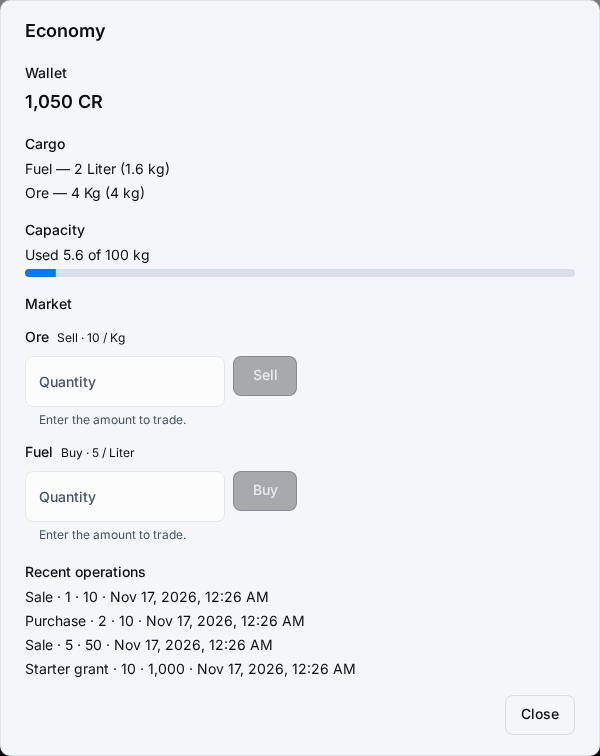
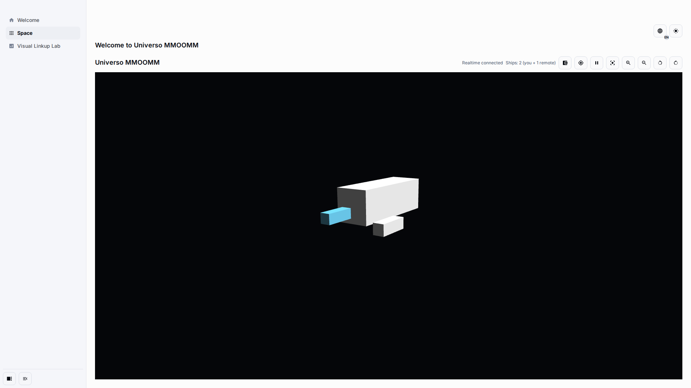

# MMOOMM Economy Guide

The MMOOMM economy adds a minimal trading loop to the canonical MMOOMM app:
nomenclature, a per-user wallet, operations, two ledger registers, and a market
panel at the flight station. Everything is built from standard platform
metadata — Objects, Sets, Enumerations, an authored server module, and the
ledger capability — plus three runtime REST routes. The flight scene itself,
the Colyseus room, and the `playcanvasCanvas` widget are described in the
[MMOOMM Flight Simulator](mmoomm-flight-simulator.md) guide.



The economy entities are authored by the product-file generator through the
metahub UI together with the rest of the MMOOMM model and are exported inside
the canonical application snapshot. A published and synced application exposes
the trading API to its members; anonymous access is not supported.

## Entity Model

-   `Nomenclature` — tradeable goods: `Code`, `Name`, `Unit`, `MassPerUnit`, `VolumePerUnit`, `BasePrice`, `Status`. The MVP seeds two rows: `ORE` (kg, sells) and `FUEL` (liter, buys).
-   `Wallet` — one wallet per user and currency: `OwnerKey`, `Currency`, `Status`. `OwnerKey` is the platform user id; rows are owner-only at runtime.
-   `Operation` — the transactional registrar: `OperationType`, `Wallet`, `Station`, `Nomenclature`, `Quantity`, `UnitPrice`, `TotalPrice`, `OccurredAt`, `Status`.
-   `OperationType` enumeration — `StarterGrant`, `Sell`, `Buy`, `Mine`, `Fee` (`Mine` and `Fee` are reserved values in the MVP).
-   `Unit` enumeration — `Kg`, `Liter`, `Unit`, `M3`.
-   `EconomyConstants` — a Set with seven fixed values (see the constants table below).

`WalletLedger` and `InventoryLedger` are register entities implemented as
object-kind entities with the ledger schema capability enabled — there is no
separate ledger kind for them. This is a documented deviation from the original
brief that follows the platform architecture rule: a register is an entity with
`config.ledger`, exactly like the LMS registers. The registrar that feeds both
registers is the `Operation` object through its posting behavior.

| Register          | Components                                                                                                                       | Projections                                      |
| ----------------- | -------------------------------------------------------------------------------------------------------------------------------- | ------------------------------------------------ |
| `WalletLedger`    | `WalletKey`, `Currency`, `OperationType`, `Amount`, `OccurredAt`, `SourceObjectId`, `SourceRowId`, `SourceLineId`                | `walletBalance`, `walletTurnover` (period `day`) |
| `InventoryLedger` | `OwnerKey`, `StationCode`, `NomenclatureCode`, `Quantity`, `Cost`, `OccurredAt`, `SourceObjectId`, `SourceRowId`, `SourceLineId` | `stockBalance`, `stockTurnover` (period `day`)   |

`fieldRoles` classify `WalletKey`/`Currency`/`OperationType` and
`OwnerKey`/`StationCode`/`NomenclatureCode` as dimensions, `Amount` and
`Quantity`/`Cost` as sum resources, and the remaining fields as plain
components. The `walletBalance` projection aggregates `Amount` per
(`WalletKey`, `Currency`); `stockBalance` aggregates `Quantity` and `Cost` per
(`OwnerKey`, `NomenclatureCode`). Both registers are append-only and
registrar-only, so direct fact appends from runtime clients are rejected.

## Posting Flow

The `Operation` record behavior is transactional with manual posting:
states `Draft` → `Posted` / `Voided`, record display prefix `OP-`, effective
date `OccurredAt`, and posted rows become immutable. Posting targets both
registers (`targetLedgers`).

Ledger movements are composed by the authored server module
`Mmoomm Economy Posting Module` (codename `mmoomm-economy-posting-module`).
The module is authored data created through the Modules tab and attached to the
`Operation` object — not platform code. Its `@OnEvent('beforePost')` handler
reads the operation row through the Record API and returns the movements. The
economy service stamps the row with server-resolved values before posting —
`UnitPrice` (the constant-driven per-unit price), `TotalPrice` (the positive
monetary magnitude: `Quantity × UnitPrice` for trades, `StartingBalance` for
the grant) and `Quantity` — so the module amounts always follow the published
constants without any baked price literals:

-   `StarterGrant` — wallet fact `+TotalPrice` CR and inventory fact `+Quantity` kg of ORE at zero cost.
-   `Sell` (ORE) — wallet fact `+TotalPrice` CR and inventory fact `−Quantity` kg with cost `TotalPrice`.
-   `Buy` (FUEL) — wallet fact `−TotalPrice` CR and inventory fact `+Quantity` liters with cost `TotalPrice`.

Every fact carries the idempotency triple `SourceObjectId` / `SourceRowId` /
`SourceLineId`, so repeated posting of the same operation can never double
count. Row creation and posting run inside a single transaction; any failure
rolls the operation back to `Draft` with zero persisted facts. Unpost and void
emit compensating facts through the append-only reversal machinery — original
facts are preserved and the projections revert.

## Trading API

Published applications expose three routes (member mode only):

-   `GET /api/v1/applications/:applicationId/runtime/economy/summary`
-   `POST /api/v1/applications/:applicationId/runtime/economy/sell`
-   `POST /api/v1/applications/:applicationId/runtime/economy/buy`

The summary computes wallet balance, cargo, capacity, market prices, recent
operations, and station proximity server-side; display names are resolved on
the server and raw identifiers never reach the panel. The first summary call
also bootstraps the user's wallet and posts the once-only StarterGrant
(`1000` CR / `10` kg ORE) under an advisory transaction lock — a documented
side-effecting GET that makes the granted state visible at first entry.

The summary response shape:

```json
{
    "wallet": { "currency": "CR", "balance": 1000 },
    "cargo": [{ "nomenclatureCode": "ORE", "nomenclatureName": "Ore", "quantity": 10, "unit": "Kg", "massKg": 10 }],
    "capacity": { "usedKg": 10, "maxKg": 100 },
    "market": [{ "nomenclatureCode": "ORE", "nomenclatureName": "Ore", "side": "sell", "price": 10, "unit": "Kg" }],
    "operations": [
        {
            "id": "01900000-0000-7000-8000-000000000000",
            "type": "StarterGrant",
            "quantity": 10,
            "total": 1000,
            "occurredAt": "2026-01-01T00:00:00.000Z"
        }
    ],
    "atStation": false,
    "stationName": null
}
```

Trade requests take a strict JSON body `{ "nomenclatureCode": "ORE", "quantity": 5 }`.
The station is resolved server-side from the live flight room; an explicit
`stationId` is accepted for compatibility but never trusted. Server-owned
fields (`ownerKey`, `walletId`, `balance`, `price`, `status`) are rejected with
HTTP 422 before any database work. A successful trade returns
`{ "operationId", "walletBalance", "cargo" }`.

### Idempotency-Key

Trades accept a standard `Idempotency-Key` header holding a UUID v7 generated
per logical click:

-   Same key and same body → the stored response is replayed without executing a second trade.
-   Same key and a different body → HTTP 409 `ECONOMY_IDEMPOTENCY_CONFLICT`.
-   Absent header → the trade runs without replay protection.
-   Malformed key → HTTP 400 before any economy work.

Keys are hashed and scoped per application and user, so a leaked key can never
replay another user's response. Stored responses live for 24 hours and are
purged on request before the gate and by a 15-minute maintenance interval. The
response row is written in the same transaction as the trade, so a crash
between commit and delivery still replays correctly on retry.

## Station Proximity

The ship position is read server-side from the authoritative Colyseus room
state (`FixedTickSceneRoom`) through a read-only room bridge — it is never
supplied by the client. Having no active flight session counts as being
out-of-station. Trades attempted outside the station's `MarketRadiusMeters`
return HTTP 409 `ECONOMY_NOT_AT_STATION`, and the panel disables its trade
buttons in that state. A station with `MarketEnabled = false` rejects trades
with `ECONOMY_MARKET_DISABLED`.

## Error Codes

All failures return `{ "error", "code" }` with a stable machine-readable code.
The runtime maps codes to localized messages (EN/RU) with an English fallback.

| Code                           | HTTP | Meaning                                                                               |
| ------------------------------ | ---- | ------------------------------------------------------------------------------------- |
| `ECONOMY_NOT_AT_STATION`       | 409  | No flight session, or the ship is outside the market radius.                          |
| `ECONOMY_UNKNOWN_NOMENCLATURE` | 404  | The requested goods code does not exist in this application.                          |
| `ECONOMY_INVALID_QUANTITY`     | 422  | Quantity must be greater than zero; also used for server-owned fields in the payload. |
| `ECONOMY_INSUFFICIENT_CARGO`   | 409  | Not enough cargo in the hold for this sale.                                           |
| `ECONOMY_INSUFFICIENT_FUNDS`   | 409  | Not enough funds in the wallet for this purchase.                                     |
| `ECONOMY_CAPACITY_EXCEEDED`    | 409  | The purchase would exceed the hold capacity.                                          |
| `ECONOMY_MARKET_DISABLED`      | 409  | The station market is disabled or the economy configuration is incomplete.            |
| `ECONOMY_IDEMPOTENCY_CONFLICT` | 409  | The key was already used with a different body.                                       |
| `ECONOMY_POSTING_FAILED`       | 500  | The trade could not be posted; the transaction rolled back.                           |

## Economy Dialog



The economy UI opens from the flight canvas toolbar (wallet icon button) in a
canonical application dialog. It refreshes automatically while open and reads
only from the summary endpoint — it never queries raw client-filtered
projections:

-   Wallet — currency code and formatted balance.
-   Cargo — per-nomenclature rows with localized names, quantity, unit, and mass.
-   Capacity — used/max kilograms with a progress bar.
-   Market — per-nomenclature sell/buy prices with quantity inputs.
-   Recent operations — the last five operations with localized type labels and timestamps.

Trade buttons are disabled with a localized tooltip while the ship is outside
the station and are additionally gated by the `editContent` permission. Every
string has EN and RU entries, error codes render through the localized
dictionary, and no raw identifiers are displayed.

## Configuration Constants

The `EconomyConstants` set is materialized into the application schema at sync
and read fail-soft by the runtime; missing or incomplete constants disable the
market with `ECONOMY_MARKET_DISABLED`.

| Constant             | Default | Meaning                                     |
| -------------------- | ------- | ------------------------------------------- |
| `CurrencyCode`       | `CR`    | Wallet and price currency code.             |
| `StartingBalance`    | 1000    | Wallet balance granted once on first entry. |
| `StartingOreKg`      | 10      | Ore granted once on first entry.            |
| `OrePricePerKg`      | 10      | Sell price for one kilogram of ORE.         |
| `FuelPricePerLiter`  | 5       | Buy price for one liter of FUEL.            |
| `MaxCargoMassKg`     | 100     | Hold capacity used by the capacity check.   |
| `MarketRadiusMeters` | 80      | Maximum distance from the station to trade. |

## Related Documentation

-   [Ledgers Guide](ledgers.md) — ledger source policies, projections, and reversal semantics shared with the economy registers.
-   [MMOOMM Flight Simulator](mmoomm-flight-simulator.md) — the flight scene, realtime room, and canvas widget that the economy attaches to.
