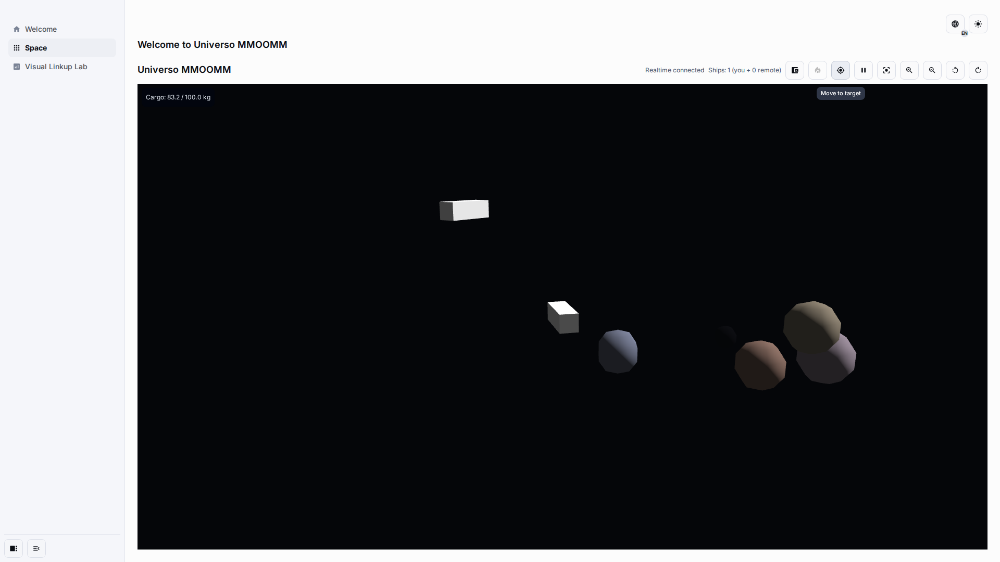

# MMOOMM Mining Guide

The MMOOMM mining loop closes the game cycle started by the
[MMOOMM Economy](mmoomm-economy.md) guide: instead of spending the starter
grant, players mine ore from a shared asteroid belt near the flight station.
Five asteroids are standard `Object` records rendered as low-poly primitives in
the existing flight canvas — no binary assets, no scene re-authoring, no new
entity kinds. Mining posts a `Mine` operation into the existing
`InventoryLedger` register through the same posting module the economy uses,
so the ore a player mines is indistinguishable from granted or purchased ore
downstream. The flight scene, the Colyseus room, and the `playcanvasCanvas`
widget are described in the [MMOOMM Flight Simulator](mmoomm-flight-simulator.md) guide.

## Entity Model

-   `Asteroid` — a belt body: `Code` (stable `AST-01`…`AST-05`), `Name`,
    `ResourceCode` (`ORE`), `PositionX/Y/Z`, `Scale`, `TotalQuantityKg`,
    `RemainingQuantityKg`, `Status`, `VisualVariant`, `ChunkMinKg`, `ChunkMaxKg`,
    `LastMinedAt`. The belt is global — every member sees the same asteroids and
    remainders; the records are not owner-only and never appear in primary
    navigation. `RemainingQuantityKg`, `Status` and `LastMinedAt` are
    **server-owned**: the generic rows API rejects client writes, and the fire
    flow is the only writer.
-   `AsteroidStatus` enumeration — `Active`, `Depleted`. A depleted asteroid
    stops accepting fire and stays depleted after reload; there is no respawn
    in the MVP.
-   `MiningConstants` — a Set with nine fixed values (see the constants table
    below).

The `Operation` object gains two additive, server-owned STRING fields:
`OperationKind` (`StarterGrant` / `Sell` / `Buy` / `Mine`) and `AsteroidCode`
(the source asteroid for `Mine`). Old operations without these fields keep
working through the posting module's fallback heuristic; every new operation
row is stamped server-side (TZ §10.3).

The `Operation` entity keeps its transactional record behavior with
**posted-row immutability**: once the fire flow posts an operation, generic
edit, delete and copy paths reject it with `RECORD_IMMUTABLE`. This is a hard
requirement behind mining — do not drop the immutability setting when editing
the Operation entity (the fixture contract check fails without it).

## Mining Loop

The client renders the belt from the state API and selects a target with a
click/tap (a drag keeps rotating the camera — the click threshold is ~6 px).
Hovering an asteroid faintly lights it up; the **selected** target keeps the
full glow, and the Fire button carries its code (`Fire: AST-04`) — the button
stays disabled until an asteroid is explicitly selected. `Fire` in the
toolbar, or the `F` key while the canvas is focused, sends the fire request;
the client runs no shot queue and applies a local cooldown after every own
shot.

Ships collide with the belt: the authored flight module reads the Asteroid
records into the room's `occupiedSpheres`, the fixed-tick movement stops the
ship at the rock surface, and the client prediction uses the same geometry —
the collider radius shrinks with the remainder in the same effective-scale
steps the renderer and the range check use.

The server validates everything and never trusts the client: member session,
`editContent` permission, an active flight session (ship position comes from
the same-process room bridge), target existence, distance against the
effective radius (`radius = scale × effectiveScale × 0.5` with
`effectiveScale = 0.55 + 0.45 × remaining/total` — the same formula the client
renders), the per-user cooldown, and cargo capacity. Chunks (1–3 per hit,
uneven, skewed toward smaller masses) are computed server-side; the chunk sum
becomes the operation quantity.

One fire = one `Mine` operation in ONE transaction: the asteroid row is locked
(`SELECT … FOR UPDATE`), the remainder is re-checked under the lock, the
operation is created and posted (a single `InventoryLedger` fact with
`Cost = 0` — the wallet gets **no** ledger movement), and the remainder,
status and `LastMinedAt` are updated with a conditional
`UPDATE … WHERE remaining >= total RETURNING`. A posting failure rolls the
operation, the facts and the remainder back atomically. Two players firing at
the same asteroid serialize on the row lock — the belt can never go negative.

## Belt State API

Published applications expose the mining routes (member mode only):

-   `GET /api/v1/applications/:applicationId/runtime/economy/mining/state` —
    the belt snapshot (codes, names, positions, scales, remainders rounded to
    0.1 kg, statuses, visual variants) plus the mining constants. The client
    polls it every `MiningStatePollMs`; TanStack Query pauses the poll while
    the tab is hidden.
-   `POST /api/v1/applications/:applicationId/runtime/economy/mining/fire` —
    the body carries **only** `asteroidCode` (any server-owned or unknown
    field is rejected with 422 `MINING_INVALID_PAYLOAD`; a missing code is a
    400 `MINING_INVALID_TARGET`). The response carries the operation id, the
    new remainder, the chunk list, the cargo `used/max` and the wallet echo.

### Idempotency-Key

`fire` accepts the standard `Idempotency-Key` header (UUID v7) with the same
semantics as trading: the same key with the same asteroid replays the stored
response, the same key with a different asteroid conflicts with
`ECONOMY_IDEMPOTENCY_CONFLICT`. The key is optional — an absent key is
protected by the cooldown and the asteroid row lock instead.

## Targeting & Controls

-   Click/tap an asteroid — select the fire target (the glow shell highlights
    it; hover shows the same highlight + distance).
-   `Fire` toolbar button or `F` — fire at the selected target; disabled
    without a target, during the cooldown, or while a shot is in flight.
-   Drag — camera orbit, unchanged; `Space` is intentionally unbound.
-   With `prefers-reduced-motion`, the beam flash and chunk drift are muted.

## Error Codes

| HTTP | Code                           | When                                            | User message (EN)       |
| ---- | ------------------------------ | ----------------------------------------------- | ----------------------- |
| 400  | `MINING_INVALID_TARGET`        | Missing/invalid `asteroidCode`                  | Choose an asteroid      |
| 401  | `MINING_AUTH_REQUIRED`         | Reserved (the shared runtime guard answers 401) | Requires login          |
| 403  | `MINING_PERMISSION_DENIED`     | Reserved (the shared runtime guard answers 403) | Not permitted           |
| 404  | `MINING_TARGET_NOT_FOUND`      | Unknown asteroid code                           | Asteroid not available  |
| 409  | `MINING_NO_FLIGHT_SESSION`     | No active flight session                        | Start a flight first    |
| 409  | `MINING_OUT_OF_RANGE`          | Distance beyond the radius                      | Asteroid too far        |
| 409  | `MINING_DEPLETED`              | Remainder is zero                               | Asteroid depleted       |
| 409  | `MINING_COOLDOWN`              | Second fire inside the window                   | Laser recharging        |
| 409  | `ECONOMY_CAPACITY_EXCEEDED`    | Hold full                                       | Sell ore at the station |
| 409  | `ECONOMY_IDEMPOTENCY_CONFLICT` | Key reuse with another asteroid                 | Reload and retry        |
| 422  | `MINING_INVALID_PAYLOAD`       | Server-owned/unknown body fields                | Invalid request         |
| 500  | `MINING_POSTING_FAILED`        | Transaction/posting failure                     | Try again in a moment   |

Codes resolve to localized EN/RU messages through the
`runtime.economyErrors.*` block; raw codes and internal ids never render.

## Mining HUD

The canvas HUD shows the cargo `used / max kg` (a warning appears at ≥ 90 %)
and the selected target with its distance and availability. The operations
list in the [economy dialog](mmoomm-economy.md) renders `Mine` rows through the
pre-wired localized label. When the hold is full, the error offers a
"Sell ore" shortcut that opens the economy dialog — it never auto-sells.

## Configuration Constants

| Constant                              | Value     | Meaning                                  |
| ------------------------------------- | --------- | ---------------------------------------- |
| `MiningRadiusMeters`                  | 80        | Max ship-to-asteroid distance for a fire |
| `MiningCooldownMs`                    | 350       | Min interval between one user's fires    |
| `ChunksPerHitMin` / `ChunksPerHitMax` | 1 / 3     | Chunk count per fire                     |
| `ChunkMassMinKg` / `ChunkMassMaxKg`   | 0.8 / 3.2 | Per-chunk mass range                     |
| `ChunkMassSkew`                       | 1.6       | Distribution skew toward smaller chunks  |
| `ChunkVisualLifetimeMs`               | 900       | Chunk visual lifetime                    |
| `MiningStatePollMs`                   | 2000      | Belt state poll interval                 |

## Related Documentation

-   [MMOOMM Economy Guide](mmoomm-economy.md) — the trading loop the mined ore
    flows into.
-   [MMOOMM Flight Simulator](mmoomm-flight-simulator.md) — flight controls and
    the canvas widget.
