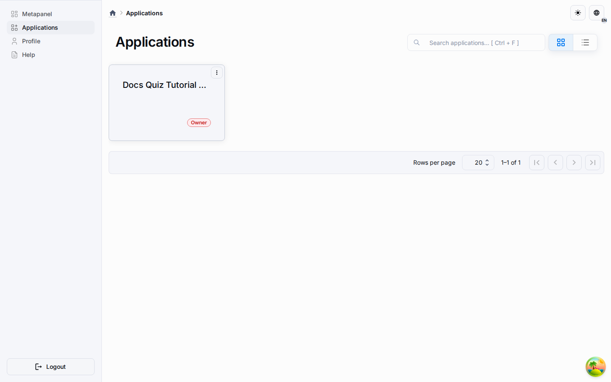

# Workspace Management

Workspace-enabled applications expose the runtime workspace model directly in the published application MUI shell.

## What Users Can Do

-   switch between available workspaces from the app navbar;
-   open the full workspace management section from the application menu or workspace switcher;
-   create a shared workspace with server-side pagination and search;
-   invite active application members by email and assign a runtime workspace role;
-   remove members from a shared workspace;
-   mark a workspace as the current default workspace;
-   convert their own personal workspace to a shared workspace in place (owners only, one-way);
-   open Workspace Settings for settings that the application administrator allows to be overridden per workspace.

## Personal And Shared Workspaces

Workspace-enabled applications use a two-tier model:

-   **Personal** workspaces are provisioned automatically for every user and stay visible only to the owner until the owner invites other users by email.
-   **Shared** workspaces are visible to every active application member with baseline `member` rights; explicit `owner` rows always win.
-   A workspace owner can convert their own personal workspace to shared **in place** through the workspace card actions menu ("Make shared"). The confirmation dialog is destructive-framed: the change is permanent, membership rows reuse the same workspace id, existing records and links are preserved, and no second workspace is created. After the conversion the workspace becomes visible to all application members; the conversion alone does not publish the workspace. Access links keep resolving through their own eligibility rules, and an administrator can additionally select the workspace as the application public entry when public runtime access is needed.
-   The conversion cannot be repeated or undone: re-converting returns HTTP 409 (`WORKSPACE_CONVERSION_BLOCKED`). If a user would leave the application while holding the only owner row of any shared workspace, the leave is rejected with HTTP 409 (`APPLICATION_MEMBER_WORKSPACE_OWNERSHIP_REQUIRED`) until ownership is transferred or the workspace is deleted.

## Why This Matters For LMS

The LMS MVP uses workspaces for collaboration boundaries.
For example, one teacher team can work in one workspace while another class team works in another, with runtime rows isolated by workspace-aware backend predicates.

## Current Roles

-   `owner`
-   `member`

These roles are stored in the application schema and are separate from global platform roles.

## Workspace Settings

Workspace Settings are explicit per-workspace overrides on top of application settings.
They are available only for setting keys allowed by the application workspace override policy.
If a key is locked by the application, the workspace page does not expose an editor for it and the runtime uses the application value.

Workspace owners can change allowed workspace settings for their workspace.
Application administrators can manage workspace settings from the runtime API even when they are not members of the target workspace.
Non-admin users who are not workspace members remain denied.

Copying a workspace copies only active overrides that are still allowed by the current application policy.
This prevents stale or locked setting keys from being carried into new workspaces.

## UI Components

The current implementation uses:

-   `WorkspaceSwitcher`
-   `RuntimeWorkspacesPage`
-   shared card/list primitives from `@universo-react/template-mui`

These components live in `packages/universo-react-apps-template-mui`. The workspace page is rendered through the existing dashboard details content slot, so published applications keep the same header, mobile navbar, side menu, and data-view styling as other runtime sections.
