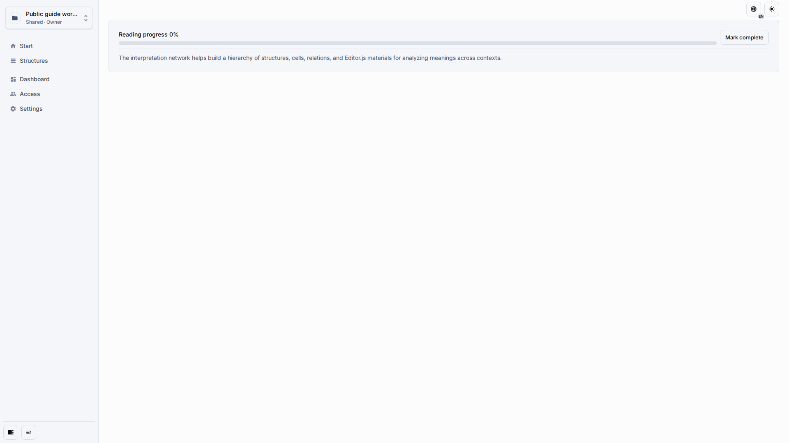
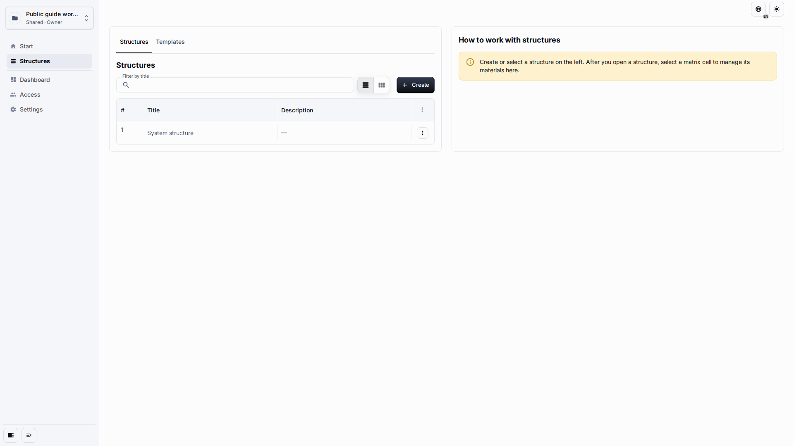

# Interpretation Network User Guide

The Interpretation Network is a workspace for building a hierarchy of concepts, comparing interpretations, and attaching source materials to the cells that explain each concept. Use this guide when you need a working application, not only the technical data model.

## Role And Goal

This page is for an application owner or editor who needs to open the published application, find the Matrix workspace, and understand where each main workflow starts.

## Access And Roles

An application marked public can provide an anonymous, read-only Interpretation Network view. The server uses its explicitly designated public-entry Workspace, or the only active shared Workspace when there is exactly one. If there is no shared Workspace or the choice is ambiguous, the application still opens and shows a localized no-workspaces message. Visitors cannot choose a Workspace or submit Matrix, Material, template, Favorite, or settings changes. The public view is limited to the published Dashboard and its supported Interpretation Network placement.

Sign in as an application member to use the authenticated runtime. The available Workspaces and edit actions depend on membership and role. Favorites belong to the current user in the active Workspace and are available only in the authenticated runtime.

## Prerequisites

-   You can sign in to Universo Platformo.
-   You have access to an application created from the Interpretation Network template or from the demonstration snapshot.
-   Your role allows content editing when you need to create cells, materials, or templates.

## Workflow

1. Open the published application and check the left navigation.

2. Open **Structures**. The default setup shows the Structure list; create or select a Structure to open its Matrix.

## Expected Result

In the authenticated runtime, you see application navigation and can open **Structures**. Workspace selection and management are available from the workspace switcher. Opening a Structure shows **Matrix**, **Favorites**, and **Templates** together in one tab row. The Materials pane follows the selected cell and opens its Primary Material directly when one is set. An anonymous public view is read-only and uses the server-selected Workspace, or shows the no-workspaces state when none is available.

## What To Check

-   The page uses the same application shell as other published apps.
-   The Matrix shows human-readable cell labels.
-   The application does not ask you to copy technical identifiers or edit hidden placement fields.

## Related Pages

-   [Getting Started](getting-started.md)
-   [Workspace And Matrix](workspace-and-matrix.md)
-   [Cells And Materials](cells-and-materials.md)
-   [Interpretation Network data model](../architecture/interpretation-network-data-model.md)
