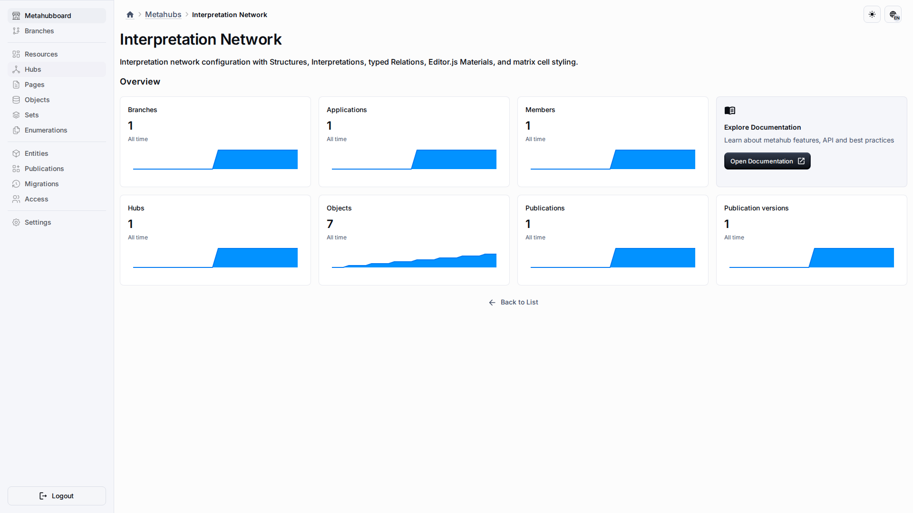
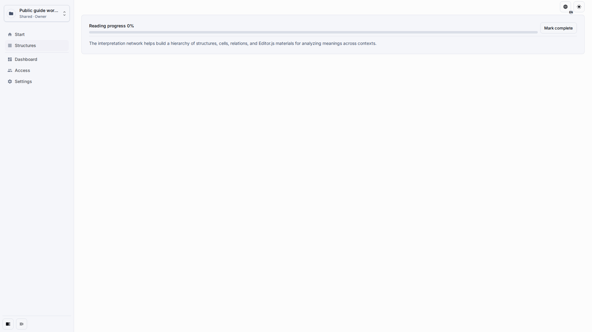
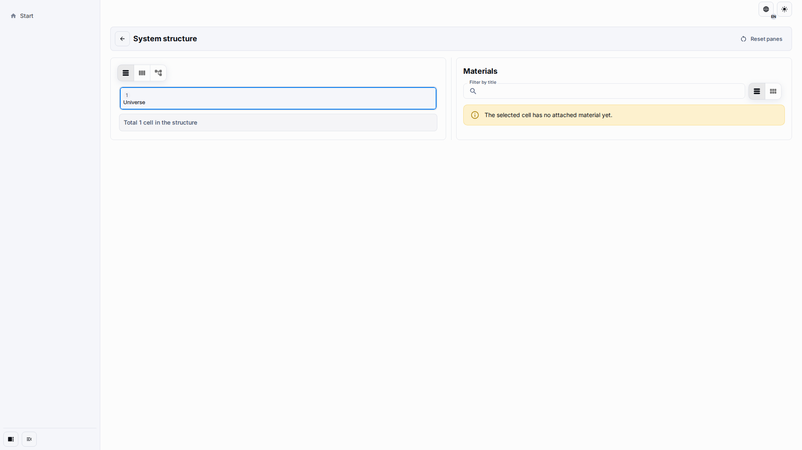

# Getting Started

Start here when you need to confirm that the template, publication, linked application, and published workspace are connected.

## Role And Goal

This page is for the owner who prepares the first usable application and for the editor who receives access to it.

## Prerequisites

-   The Interpretation Network template is available in the metahub catalog.
-   You can create or import a metahub and create a linked application from its publication.
-   For the demonstration path, use the prepared snapshot file supplied with the repository.

## Workflow

1. Create or import the Interpretation Network metahub and open it after the import finishes.

2. Open the linked application. Sign in to use the workspace switcher and authenticated navigation; an anonymous visitor to a public application receives its read-only public view.

3. Open the public application in a signed-out browser to review the configured entry Workspace without editing controls.

## Expected Result

In the authenticated runtime, application members can open **Structures** and select an authorized Workspace from the workspace switcher. The anonymous public view does not show a workspace switcher: the server selects the explicitly configured public-entry Workspace, or the only active shared Workspace. When neither is available unambiguously, the public application still opens and displays a localized no-workspaces state without content mutations.

## What To Check

-   The imported metahub title matches the Interpretation Network template.
-   The linked application opens without a separate development server.
-   Users see only normal product navigation and localized labels.
-   Public visibility provides read-only access; editing, templates, Favorites, and Workspace selection require the authenticated runtime.

## Related Pages

-   [Create And Publish](create-and-publish.md)
-   [Snapshot Export & Import](../guides/snapshot-export-import.md)
-   [Creating Applications](../guides/creating-application.md)
