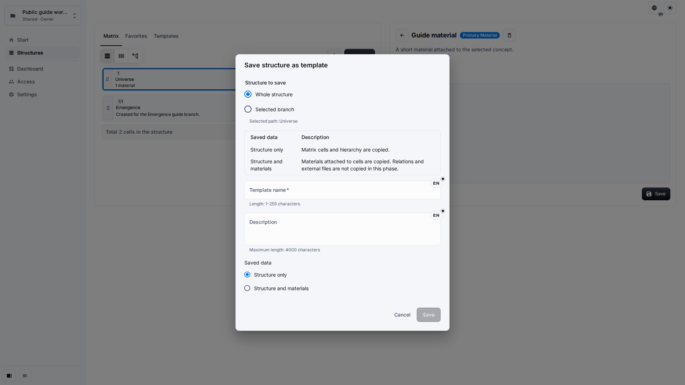
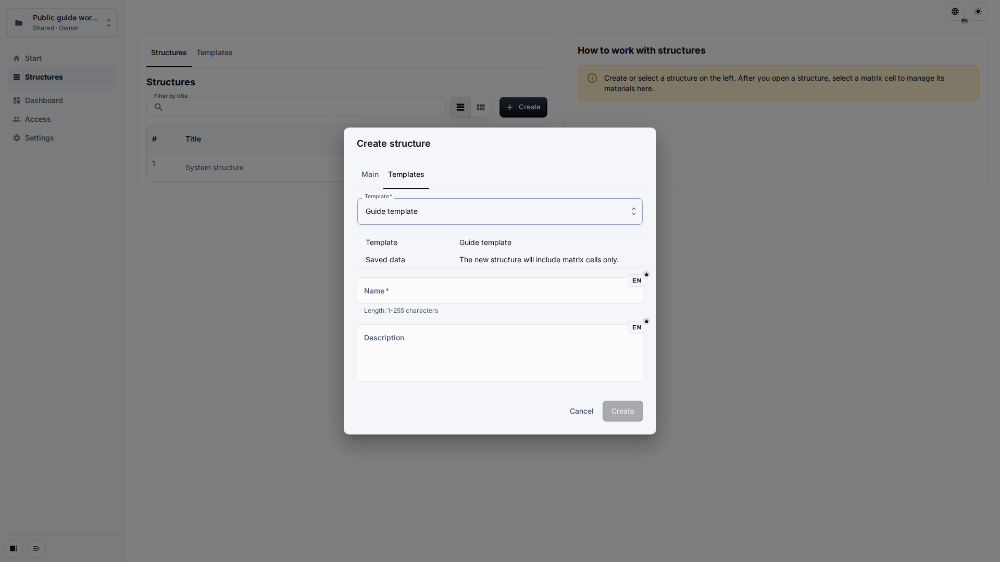
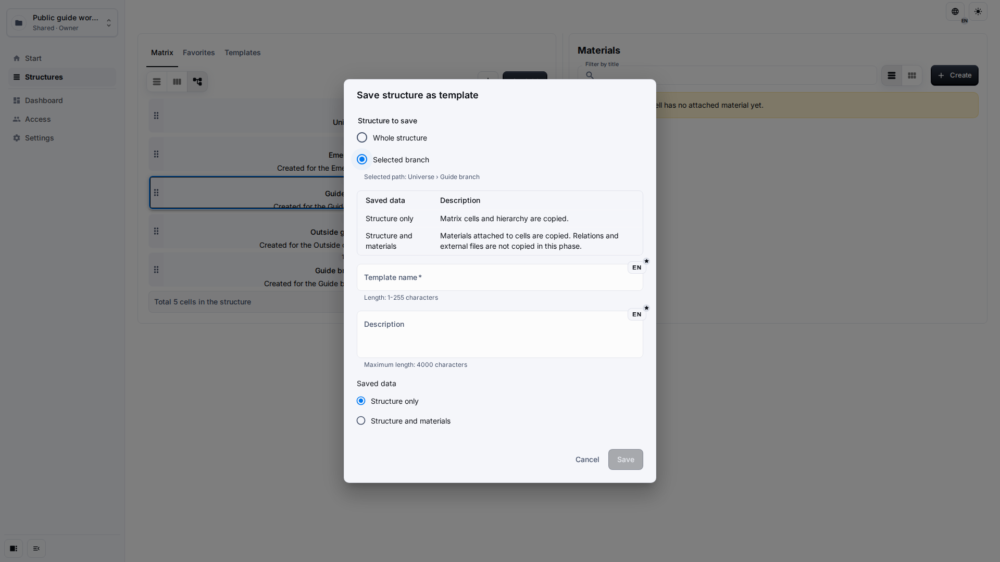

# Templates

Templates let editors reuse a Matrix structure inside the same application workspace. A template can copy only the structure or copy the structure together with its Materials.

## Role And Goal

This page is for an editor who needs to save a useful Matrix shape and create another Structure from it later.

## Prerequisites

-   You can edit the Matrix that should become a template.
-   Template panels are enabled in Application Settings.
-   Your role allows both content creation and content editing.

## Workflow

1. Open the Matrix and click **Save as template**.

2. Open the **Templates** tab to review available templates and their saved data policy.

3. In multiple-Structure mode, create a Structure and choose the **Templates** tab in the create dialog.

4. To save part of a hierarchy, select its root cell, open **Save as template**, and choose **Selected branch**.

**Insert into an existing hierarchy:** select the destination cell and use its **Cell actions → Insert saved template** menu item. Review the template, then choose **Insert into** the selected cell. The template root becomes a child of that cell.

## Expected Result

The saved template is available only in the current application workspace. A template can cover the whole Structure or, in hierarchical Matrix mode, the selected branch. In hierarchical mode, editors can either create a new Structure from a template or insert it below a selected cell in the current Structure. When creating or inserting from a template that includes Materials, the runtime creates fresh cell, row, and Material identities and attaches copied Materials to their corresponding cells. The source Matrix and saved template remain unchanged. Insertion requires the editor to be allowed to create and edit content in the active workspace.

## What To Check

-   The saved data policy matches your intention.
-   Selected-branch templates are used with hierarchical cells; choose whole-Structure scope when the Matrix uses independent rows.
-   The **Insert saved template** action is available from a selected hierarchical cell; it inserts below that target and does not replace the target cell.
-   The template list shows readable names and descriptions.
-   One-system mode hides creation of an additional Structure from a template, while still allowing the current Matrix to be saved.

## Related Pages

-   [Application Settings](application-settings.md)
-   [Workspace And Matrix](workspace-and-matrix.md)
-   [Cells And Materials](cells-and-materials.md)
