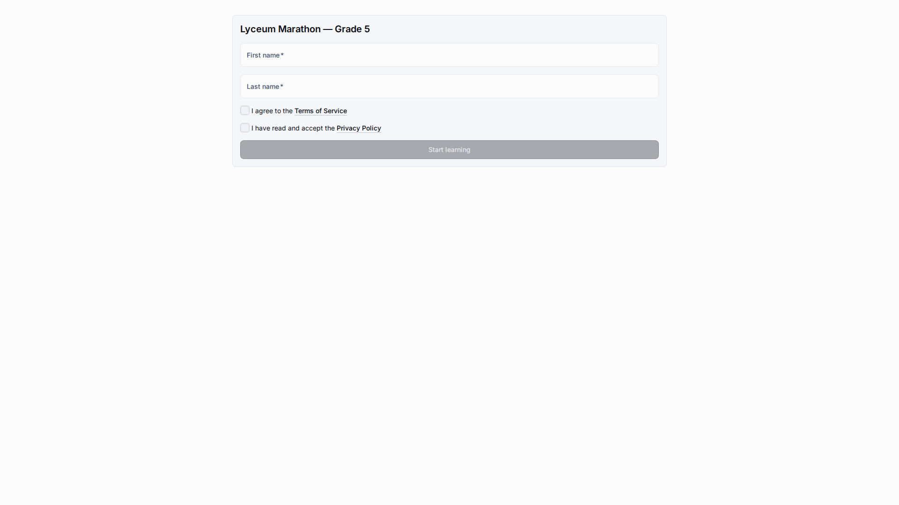
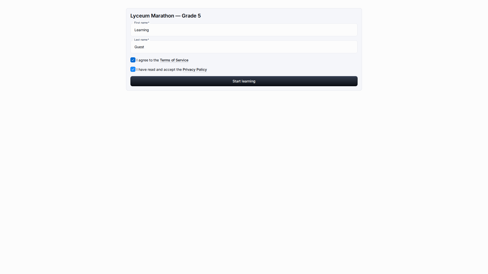
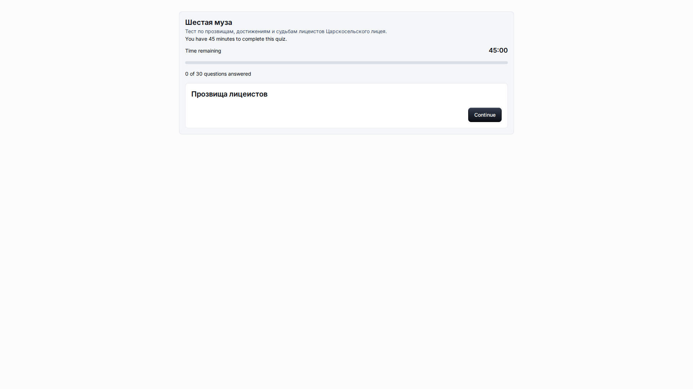
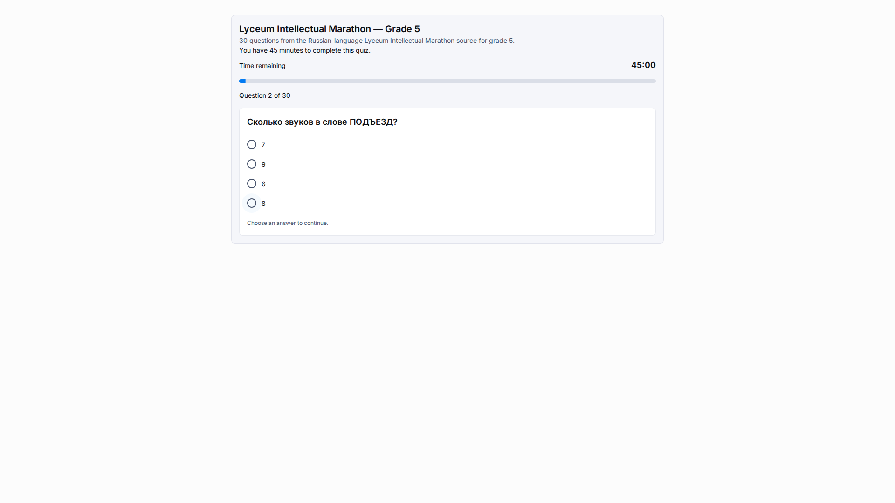
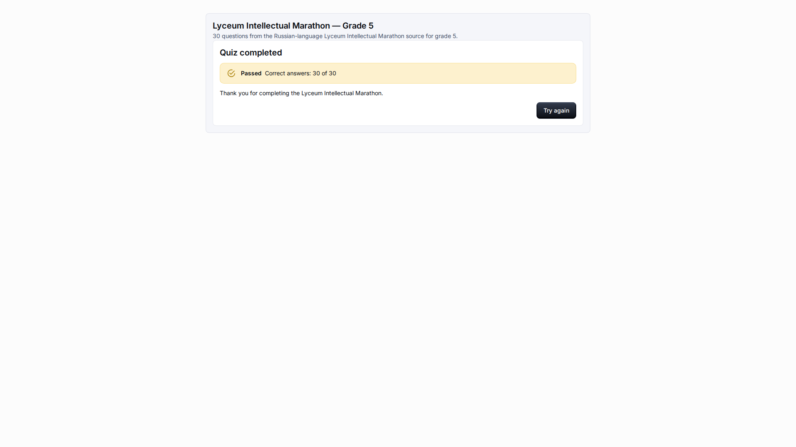
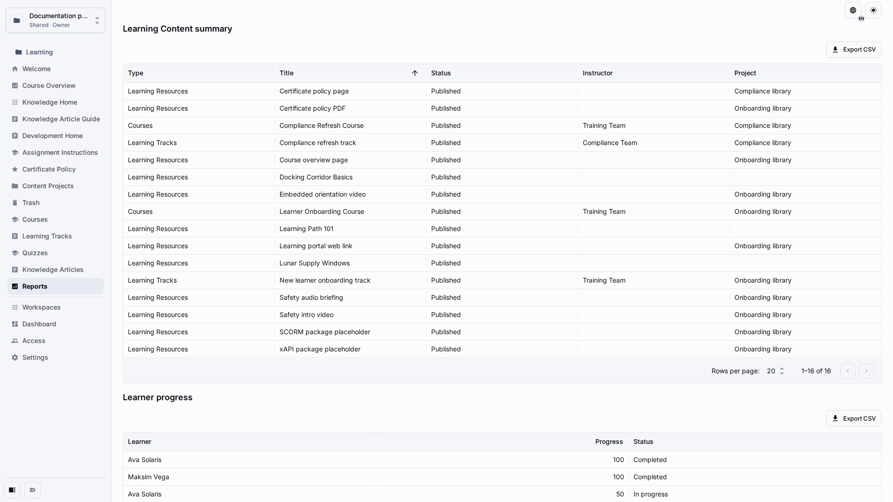

# Guest Access

Each class has its own public link to the Lyceum Intellectual Marathon. Participants open the link in a browser, enter their name, and take the quiz without registering on the platform. The example below uses the grade 5 quiz; the other grades follow the same steps and use their own questions.

## Take the Quiz

1. Open the link shared for your class. Check that the page names the Lyceum Marathon and shows the guest form. You do not need to sign in or create an account. If the organizer sent a short link, open it directly; it takes you to the same quiz entry page.
   

2. Enter your first and last name, then accept both the Terms of Service and the Privacy Policy. Both confirmations are required to begin. The organizer has turned off the “I am not a robot” check for this event. Select **Start learning** once the form is complete; the quiz opens in the same browser tab. In the Sixth Muse example, the first screen introduces the block and the timer starts immediately.
   

3. Select **Continue** to open the block's questions, then answer one question at a time. Each question has four choices, and the timer gives you 30 minutes for the whole quiz. In a block-based quiz, read each block's title and introduction before continuing; the timer keeps running there by default, although the organizer can pause it. Question numbers are global by default; a quiz can instead show block-relative numbers such as `1.1` and `2.1`. By default, selecting an option saves it automatically and advances after the server confirms it. The organizer can enable answer confirmation in the quiz settings; in that mode, you can change your selection until you choose **Submit answer**. If saving fails, keep the page open and retry the selected answer. The quiz does not show which option is correct while you are answering.
   

4. Continue until all 30 questions are answered. The final answer completes the attempt and opens your result, including the number of correct answers and the organizer’s closing message. The result is saved with your name and completion time. If the timer expires first, the application scores answers that were already saved.
   

5. If the page reloads or the connection briefly drops, reopen the same class link in the same browser. An unfinished attempt resumes with its saved answers and original deadline. After the quiz is complete, authorized staff can review the saved participant name, class, completion time, and score in the application’s quiz results report.
   

## For Organizers

Prepare and publish one quiz for each class in the application workspace:

-   Open **Quizzes** in the application sidebar, or choose **Content Projects → Quizzes**. Create a quiz, add its questions and four answer choices, mark the correct choice, set the time limit, and add the completion message. The **Confirm answer before continuing** setting is off by default; enable it when participants should choose **Submit answer** after selecting an option.
-   For a block-based quiz, add ordered rows to **Blocks**, give each one a title and optional introduction, then select the matching block in each question's **Block** field. The timer continues through block introductions by default; turn on **Pause timer on block introductions** to freeze it there. **Number questions within each block** switches from global numbering to labels such as `1.1`, `1.2`, and `2.1`. Adding the first block to an existing quiz asks for confirmation before assigning its questions. Removing the final block asks before returning to a flat quiz. Cancel keeps both tables unchanged. Give each block at least one question, then save the quiz once to persist both tables together.
-   Open **Guest links**, select the quiz, and choose **Create**. Set a readable title and access key, then choose which identity fields to show and require. The Terms of Service and Privacy Policy confirmations remain mandatory. For the Marathon, first and last name are required, email and phone are hidden, and the robot check is off.
-   Make the application public in **Application settings** so anonymous visitors can open its guest URLs.
-   Open the application board and select **Guest and short links**. The **Full guest quiz links** table shows each complete direct URL and a **Copy link** button. Copy the appropriate class link and share it with participants. To create an optional shorter `/l/<slug>` address, use the form on the same page and choose the quiz access link as its destination. A QR code can be generated from either URL using an external QR-code service.

The guest link controls the intake policy and access to the attempt. A short `/l/<slug>` address is an optional alias to that guest link. Keep the application public and the guest link active while participants are testing. Managing these settings requires the application’s **Manage application** permission; ask an application owner or administrator if the controls are unavailable.

The application records each completed attempt for staff who have permission to view reports. A participant using a public link can see their own attempt and result, but cannot browse other participants' results or open staff reports. Disabling a quiz guest link or withdrawing the application revokes guest access while retaining saved results for authorized reports. Deleting the workspace archives its quiz results with the workspace; the normal report only lists active workspaces.

## Screen Details

| Screen         | What it shows                                                                                             |
| -------------- | --------------------------------------------------------------------------------------------------------- |
| Guest entry    | The public quiz link and participant form.                                                                |
| Block intro    | The current block's title and introduction, with a **Continue** button to begin its questions.            |
| First question | Four choices, the question counter, and the timer.                                                        |
| Next question  | Appears after the answer is saved, immediately by default or after participant confirmation when enabled. |
| Final result   | The participant’s score and closing message.                                                              |
| Staff report   | Saved participant, completion time, and quiz score.                                                       |

## Related Pages

-   [Learner Experience](learner-experience.md)
-   [LMS Reports](reports.md)
-   [Technical guest-access guide](../guides/lms-guest-access.md)
