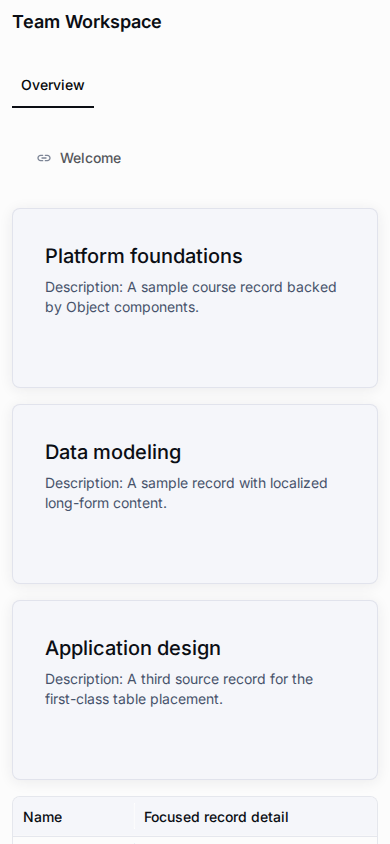

# Messenger App Template



The `messenger-app` is an Application Layout template for a published, read-only runtime inside Telegram or MAX webviews. It uses the shared application layout and widget registries and the isolated `@universo-react/apps-template-mui` renderer. The same public URL remains usable in an ordinary browser.

Messenger is a layout template, not a separate Application or Metahub template. Create an Application through the normal flow and ensure its runtime schema is ready. When creating the first global layout under **Application → Layouts**, choose `messenger-app` from the existing template selector. Selecting it seeds the shared header, localized Overview tab, and generated entity-navigation menu in the same transaction as the layout; no layout means no default Messenger runtime. The Overview menu lists published Pages and Objects explicitly marked for primary navigation. It never includes workspace or administration destinations, raw identifiers, or record rows. The first active global layout is the default. The layout uses three semantic regions: `top` (header), `center` (main content), and `bottom` (footer/actions).

## Compose a read-only application

Use the existing layout authoring surface to add supported widgets. The MVP supports the required overview cards, record list/table, record details, tabs, resource preview, columns, chart, and a read-only relationship viewer. The server validates placements against the Messenger template and projects only bounded, anonymous-safe data to a public runtime. Platform navigation, workspace switching, authoring, administration, and mutation controls are not part of the Messenger surface.

Content remains in the application's published metahub records. Layout placements control composition and presentation; they do not copy content into widget JSON. The standard copy, snapshot, restore, synchronization, and materialization flows preserve the selected template and its placements.

A new Messenger layout starts with the shared header and a localized **Overview** tab containing the generated navigation menu in the center region; the bottom region is empty. The menu is an entity overview, not a list of records. Data-backed widgets such as record lists and overview cards require an explicit binding to a real data source. Add a supported widget and configure that binding to display published records; until then its shared localized empty state is shown. No sample records or invalid bindings are inserted.

### Allow fields in anonymous Messenger output

In the metahub Component editor, open **Presentation** and enable **Allow anonymous Messenger display** only for a field whose every value is safe for anyone to read. The setting is off by default. Anonymous Messenger projectors omit unapproved fields and continue to reject hidden, server-owned, technical, and sensitive fields. The opt-in is an author declaration, not automatic personal-data detection; review records written to an approved field and do not store names, contact details, credentials, or other private data there.

## Public access and catalog discovery

Runtime access and catalog discovery are independent settings. **Public** controls whether an anonymous visitor can open the published runtime. **Show in application list** controls whether a public application appears to non-members in the ordinary application catalog.

| Application state                     | Visible to non-members in catalog                 | Direct public runtime                  |
| ------------------------------------- | ------------------------------------------------- | -------------------------------------- |
| Public and listed                     | Yes                                               | Available when published and ready     |
| Public and unlisted                   | No                                                | Available when published and ready     |
| Closed, regardless of list preference | No                                                | Unavailable to anonymous visitors      |
| Member or authorized `showAll` viewer | Visible under existing membership/privilege rules | Existing runtime authorization applies |

Hiding an application from the catalog is not access control. Members retain their normal access, and a public unlisted application remains available through its UUID or configured public alias. Changing public/closed status does not erase the saved catalog preference.

## Bind Telegram and MAX bots

Application administrators manage bot bindings in the Application settings. Each binding identifies one platform and bot username; one Application may have multiple bindings, including multiple bots on the same platform. The binding status is an operator-managed record and does not mean Universo has contacted or verified the external platform.

The optional display name is a short operator label (up to 120 Unicode code points). The form, API contract, and database reject common contact and credential patterns, including phone-like strings written with non-Latin decimal digits; this is a best-effort check, so do not use the field for contact details, user data, or secrets.

Telegram usernames accept 5–32 Latin letters, numbers, or underscores; an initial `@` is removed before saving. MAX usernames accept 11–60 Latin letters, numbers, or underscores, must start with a letter, must end in `bot` or `_bot`, and must not include `@`. See [Telegram bot features](https://core.telegram.org/bots/features) and [MAX bot creation rules](https://dev.max.ru/docs/chatbots/bots-create/create).

| Status   | Meaning                                                       |
| -------- | ------------------------------------------------------------- |
| Draft    | Binding is recorded but has not been marked ready for launch. |
| Active   | The management surface can show its generated launch link.    |
| Disabled | Reversible pause; the binding can be reactivated.             |

Release is an irreversible lifecycle action, not a fourth status. It retires the binding while retaining its row and launch identifier permanently; the binding cannot be reactivated and the identifier cannot be reused.

The launch link uses the application's canonical public URL and the server-generated `short_id`:

```text
https://t.me/<bot_username>?startapp=<short_id>
https://max.ru/<bot_username>?startapp=<short_id>
```

Configure the Telegram bot's **Main Mini App** or a supported `web_app` entry with the canonical public Web App URL. Configure the MAX bot's Mini App with the same URL. Bot creation, moderation, bot tokens, and external platform credentials stay in the platform owner's account and are not managed by Universo. A binding must not be treated as proof that the external bot is configured.

Edits and irreversible release use the binding API's expected-version contract. If another administrator has changed a binding first, the stale edit is rejected and the current state must be reloaded before retrying.

## Runtime and security boundary

-   The anonymous Messenger runtime is read-only and requires an otherwise public, published, ready Application.
-   `short_id` is an attribution hint, never a credential or authorization grant. Unknown, disabled, or released attribution falls back to the normal public Application runtime.
-   Telegram and MAX bridge integrations are detected separately and are progressive enhancements. Normal browser navigation works when neither bridge is available.
-   When MAX exposes `WebApp.getViewportSize()`, the runtime validates and applies its height and re-reads it after window resize, `visualViewport` resize, and orientation changes. Missing, invalid, or failed responses keep the CSS viewport fallback.
-   Bridge-provided `initDataUnsafe` and messenger user identity are not trusted for authorization. The MVP does not authenticate a Universo user from messenger launch data.
-   The feature does not store bot tokens, webhook secrets, `initData`, messenger-user identifiers, or session credentials.
-   Public data is selected and bounded by server-side read projectors. The browser does not choose a workspace or submit runtime mutations.
-   FR-038 launch-source metrics are deferred in this MVP because the repository has no product telemetry sink. The runtime may read only the opaque `start_param` hint and ask the same-origin resolver whether it matches an active binding for the Application already being rendered. This hint is never authorization, and the runtime does not trust `initDataUnsafe`, read messenger identity, or persist launch-source events. Unknown, disabled, and released IDs keep the ordinary public runtime available.

## Verification

The canonical fixture and focused E2E gate create a Messenger metahub through the product APIs, export and validate its snapshot, then import it for runtime checks. Run the repository's Messenger verification gate from the project root:

```bash
pnpm run test:e2e:messenger-app:verify:local-supabase
```

The gate uses the minimal local Supabase profile, regenerates the fixture, checks its contract and drift, and runs the focused Playwright runtime flow. Browser screenshots and their viewport details are retained with the E2E artifacts. Actual Telegram and MAX clients require separate manual acceptance; browser bridge stubs do not prove external client configuration or eligibility.

See [Public applications, aliases, and global short links](public-applications-and-aliases.md), [Application Layouts](../guides/application-layouts.md), and [Browser E2E testing](../guides/browser-e2e-testing.md) for related runtime and test workflows.
