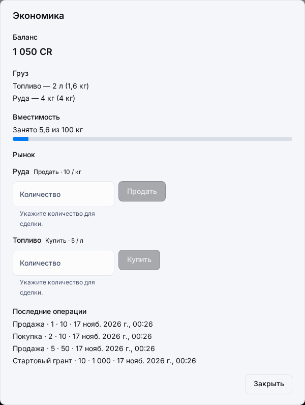
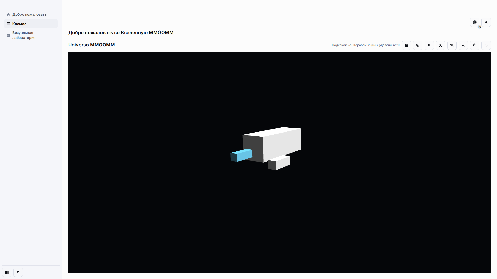

# Руководство по экономике MMOOMM

Экономика MMOOMM добавляет минимальный торговый цикл в каноничное приложение
MMOOMM: номенклатуру, кошелёк пользователя, операции, два регистра и панель
рынка на космической станции. Всё построено на стандартных метаданных
платформы — Objects, Sets, Enumerations, авторском серверном модуле и
возможности ledger — плюс три runtime REST-маршрута. Сама полётная сцена,
комната Colyseus и виджет `playcanvasCanvas` описаны в руководстве
[MMOOMM Flight Simulator](mmoomm-flight-simulator.md).



Сущности экономики создаются генератором продуктового файла через UI метахаба
вместе с остальной моделью MMOOMM и экспортируются внутри каноничного снимка
приложения. Опубликованное и синхронизированное приложение открывает торговый
API своим участникам; анонимный доступ не поддерживается.

## Модель сущностей

-   `Nomenclature` — торгуемые товары: `Code`, `Name`, `Unit`, `MassPerUnit`, `VolumePerUnit`, `BasePrice`, `Status`. В MVP засеяны две строки: `ORE` (кг, продажа) и `FUEL` (литр, покупка).
-   `Wallet` — один кошелёк на пользователя и валюту: `OwnerKey`, `Currency`, `Status`. `OwnerKey` — идентификатор пользователя платформы; строки доступны только владельцу.
-   `Operation` — транзакционный регистратор: `OperationType`, `Wallet`, `Station`, `Nomenclature`, `Quantity`, `UnitPrice`, `TotalPrice`, `OccurredAt`, `Status`.
-   Перечисление `OperationType` — `StarterGrant`, `Sell`, `Buy`, `Mine`, `Fee` (`Mine` и `Fee` — зарезервированные значения MVP).
-   Перечисление `Unit` — `Kg`, `Liter`, `Unit`, `M3`.
-   `EconomyConstants` — Set с семью фиксированными значениями (см. таблицу констант ниже).

`WalletLedger` и `InventoryLedger` — сущности регистров, реализованные как
entities типа object со включённой возможностью ledger schema — отдельного
типа ledger для них нет. Это документированное отклонение от исходного брифа,
следующее архитектурному правилу платформы: регистр — это entity с
`config.ledger`, как и регистры LMS. Регистратором, питающим оба регистра,
выступает объект `Operation` через своё posting-поведение.

| Регистр           | Компоненты                                                                                                                       | Проекции                                         |
| ----------------- | -------------------------------------------------------------------------------------------------------------------------------- | ------------------------------------------------ |
| `WalletLedger`    | `WalletKey`, `Currency`, `OperationType`, `Amount`, `OccurredAt`, `SourceObjectId`, `SourceRowId`, `SourceLineId`                | `walletBalance`, `walletTurnover` (период `day`) |
| `InventoryLedger` | `OwnerKey`, `StationCode`, `NomenclatureCode`, `Quantity`, `Cost`, `OccurredAt`, `SourceObjectId`, `SourceRowId`, `SourceLineId` | `stockBalance`, `stockTurnover` (период `day`)   |

`fieldRoles` классифицирует `WalletKey`/`Currency`/`OperationType` и
`OwnerKey`/`StationCode`/`NomenclatureCode` как dimensions, `Amount` и
`Quantity`/`Cost` — как resources с агрегатом sum, а остальные поля — как
обычные components. Проекция `walletBalance` агрегирует `Amount` по
(`WalletKey`, `Currency`); `stockBalance` агрегирует `Quantity` и `Cost` по
(`OwnerKey`, `NomenclatureCode`). Оба регистра append-only и registrar-only,
поэтому прямое добавление фактов из runtime-клиентов отклоняется.

## Posting-цикл

Поведение записей `Operation` — transactional с ручным posting: состояния
`Draft` → `Posted` / `Voided`, префикс отображения записей `OP-`, дата
эффективности `OccurredAt`, проведённые строки становятся неизменяемыми.
Posting направляет движения в оба регистра (`targetLedgers`).

Движения по регистрам формирует авторский серверный модуль
`Mmoomm Economy Posting Module` (кодовое имя `mmoomm-economy-posting-module`).
Модуль — это авторские данные, созданные через вкладку Modules и привязанные к
объекту `Operation`, а не код платформы. Его обработчик `@OnEvent('beforePost')`
читает строку операции через Record API и возвращает движения. Перед проведением
сервис экономики штампует строку серверными значениями — `UnitPrice`
(цена за единицу из констант), `TotalPrice` (положительная денежная величина:
`Quantity × UnitPrice` для сделок, `StartingBalance` для гранта) и `Quantity`, —
поэтому суммы модуля всегда следуют опубликованным константам без запечённых
ценовых литералов:

-   `StarterGrant` — факт кошелька `+TotalPrice` CR и факт инвентаря `+Quantity` кг ORE с нулевой стоимостью.
-   `Sell` (ORE) — факт кошелька `+TotalPrice` CR и факт инвентаря `−Quantity` кг со стоимостью `TotalPrice`.
-   `Buy` (FUEL) — факт кошелька `−TotalPrice` CR и факт инвентаря `+Quantity` литров со стоимостью `TotalPrice`.

Каждый факт несёт идемпотентную тройку `SourceObjectId` / `SourceRowId` /
`SourceLineId`, поэтому повторный posting той же операции никогда не задваивает
учёт. Создание строки и posting выполняются в одной транзакции; любой сбой
откатывает операцию к `Draft` без единого сохранённого факта. Unpost и void
выпускают компенсирующие факты через append-only сторно — исходные факты
сохраняются, а проекции восстанавливаются.

## Торговый API

Опубликованные приложения открывают три маршрута (только режим участника):

-   `GET /api/v1/applications/:applicationId/runtime/economy/summary`
-   `POST /api/v1/applications/:applicationId/runtime/economy/sell`
-   `POST /api/v1/applications/:applicationId/runtime/economy/buy`

Summary вычисляет баланс кошелька, груз, вместимость, рыночные цены, последние
операции и близость к станции на сервере; отображаемые имена резолвятся на
сервере, и сырые идентификаторы не попадают в панель. Первый вызов summary
также создаёт кошелёк пользователя и проводит однократный StarterGrant
(`1000` CR / `10` кг ORE) под advisory-блокировкой транзакции —
документированный GET с побочным эффектом, делающий выданное состояние видимым
при первом входе.

Форма ответа summary:

```json
{
    "wallet": { "currency": "CR", "balance": 1000 },
    "cargo": [{ "nomenclatureCode": "ORE", "nomenclatureName": "Ore", "quantity": 10, "unit": "Kg", "massKg": 10 }],
    "capacity": { "usedKg": 10, "maxKg": 100 },
    "market": [{ "nomenclatureCode": "ORE", "nomenclatureName": "Ore", "side": "sell", "price": 10, "unit": "Kg" }],
    "operations": [
        {
            "id": "01900000-0000-7000-8000-000000000000",
            "type": "StarterGrant",
            "quantity": 10,
            "total": 1000,
            "occurredAt": "2026-01-01T00:00:00.000Z"
        }
    ],
    "atStation": false,
    "stationName": null
}
```

Торговые запросы принимают строгое JSON-тело `{ "nomenclatureCode": "ORE", "quantity": 5 }`.
Станция резолвится на сервере из активной полётной комнаты; явный `stationId`
принимается для совместимости, но никогда не считается доверенным. Серверные
поля (`ownerKey`, `walletId`, `balance`, `price`, `status`) отклоняются с
HTTP 422 до любой работы с базой. Успешная сделка возвращает
`{ "operationId", "walletBalance", "cargo" }`.

### Idempotency-Key

Торговые запросы принимают стандартный заголовок `Idempotency-Key` с UUID v7,
создаваемым на одно логическое нажатие:

-   Тот же ключ и то же тело → сохранённый ответ воспроизводится повторно без второй сделки.
-   Тот же ключ и другое тело → HTTP 409 `ECONOMY_IDEMPOTENCY_CONFLICT`.
-   Отсутствующий заголовок → сделка выполняется без защиты от повтора.
-   Некорректный ключ → HTTP 400 до любой экономической работы.

Ключи хешируются и ограничиваются приложением и пользователем, поэтому
утечка ключа не позволяет воспроизвести ответ другого пользователя. Сохранённые
ответы живут 24 часа и вычищаются по запросу перед проверкой и фоновым
интервалом обслуживания в 15 минут. Строка ответа пишется в той же транзакции,
что и сделка, поэтому сбой между фиксацией и доставкой корректно
воспроизводится при повторе.

## Близость к станции

Позиция корабля читается на сервере из авторитетного состояния комнаты Colyseus
(`FixedTickSceneRoom`) через read-only мост — клиент её не передаёт. Отсутствие
активной полётной сессии считается вне станции. Сделки вне радиуса
`MarketRadiusMeters` станции возвращают HTTP 409 `ECONOMY_NOT_AT_STATION`, и
панель в этом состоянии отключает торговые кнопки. Станция с
`MarketEnabled = false` отклоняет сделки с `ECONOMY_MARKET_DISABLED`.

## Коды ошибок

Все сбои возвращают `{ "error", "code" }` со стабильным машиночитаемым кодом.
Runtime отображает коды в локализованные сообщения (EN/RU) с английским запасным вариантом.

| Код                            | HTTP | Значение                                                                              |
| ------------------------------ | ---- | ------------------------------------------------------------------------------------- |
| `ECONOMY_NOT_AT_STATION`       | 409  | Нет полётной сессии либо корабль вне рыночного радиуса.                               |
| `ECONOMY_UNKNOWN_NOMENCLATURE` | 404  | Запрошенный код товара отсутствует в этом приложении.                                 |
| `ECONOMY_INVALID_QUANTITY`     | 422  | Количество должно быть больше нуля; также используется для серверных полей в payload. |
| `ECONOMY_INSUFFICIENT_CARGO`   | 409  | В трюме недостаточно груза для этой продажи.                                          |
| `ECONOMY_INSUFFICIENT_FUNDS`   | 409  | В кошельке недостаточно средств для этой покупки.                                     |
| `ECONOMY_CAPACITY_EXCEEDED`    | 409  | Покупка превысила бы вместимость трюма.                                               |
| `ECONOMY_MARKET_DISABLED`      | 409  | Рынок станции отключён или конфигурация экономики неполна.                            |
| `ECONOMY_IDEMPOTENCY_CONFLICT` | 409  | Ключ уже использовался с другим телом.                                                |
| `ECONOMY_POSTING_FAILED`       | 500  | Сделку не удалось провести; транзакция откатилась.                                    |

## Диалог экономики



Экономический интерфейс открывается из тулбара полотна полёта (кнопка с иконкой
кошелька) в каноническом диалоге приложения. Пока диалог открыт, данные обновляются
автоматически; читается только summary-маршрут — сырые клиентские проекции он не запрашивает:

-   Кошелёк — код валюты и форматированный баланс.
-   Груз — строки по номенклатуре с локализованными названиями, количеством, единицей и массой.
-   Вместимость — занято/максимум килограммов с индикатором прогресса.
-   Рынок — цены продажи/покупки по номенклатуре с полями количества.
-   Последние операции — пять последних операций с локализованными метками типов и временем.

Торговые кнопки отключены с локализованной подсказкой, пока корабль вне
станции, и дополнительно ограничены правом `editContent`. Каждая строка имеет
варианты EN и RU, коды ошибок выводятся через локализованный словарь, а сырые
идентификаторы не показываются.

## Константы конфигурации

Set `EconomyConstants` материализуется в схему приложения при синхронизации и
читается runtime-ом в режиме fail-soft; отсутствующие или неполные константы
отключают рынок с `ECONOMY_MARKET_DISABLED`.

| Константа            | Значение по умолчанию | Значение                                                 |
| -------------------- | --------------------- | -------------------------------------------------------- |
| `CurrencyCode`       | `CR`                  | Код валюты кошелька и цен.                               |
| `StartingBalance`    | 1000                  | Баланс кошелька, выдаваемый однократно при первом входе. |
| `StartingOreKg`      | 10                    | Руда, выдаваемая однократно при первом входе.            |
| `OrePricePerKg`      | 10                    | Цена продажи одного килограмма ORE.                      |
| `FuelPricePerLiter`  | 5                     | Цена покупки одного литра FUEL.                          |
| `MaxCargoMassKg`     | 100                   | Вместимость трюма для проверки вместимости.              |
| `MarketRadiusMeters` | 80                    | Максимальное расстояние до станции для сделок.           |

## Связанные материалы

-   [Руководство по Регистрам](ledgers.md) — политики источников, проекции и сторно, общие с регистрами экономики.
-   [Руководство по Добыче MMOOMM](mmoomm-mining.md) — добычный цикл, поставляющий руду в тот же регистр `InventoryLedger`.
-   [MMOOMM Flight Simulator](mmoomm-flight-simulator.md) — полётная сцена, realtime-комната и виджет полотна, к которым привязана экономика.
