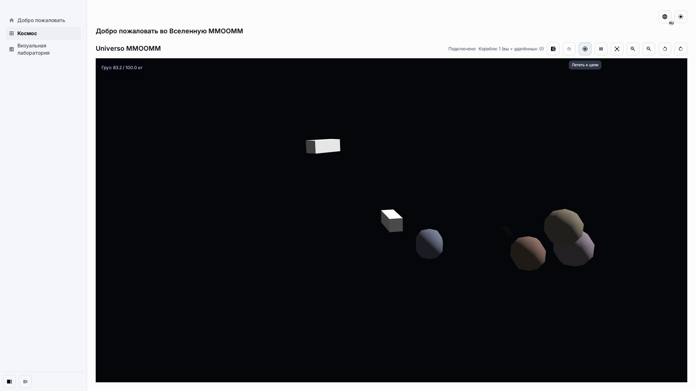

# MMOOMM Mining Guide

Добыча MMOOMM замыкает игровой цикл, начатый в
[MMOOMM Economy](mmoomm-economy.md): вместо расходования стартового grant'а
игроки добывают руду в общем поясе астероидов возле летной станции. Пять
астероидов — стандартные записи `Object`, отрисованные низкополигональными
примитивами в существующей летной сцене — без бинарных ассетов, без
переавторинга сцены и без новых kind-типов. Добыча проводит операцию `Mine` в
существующий регистр `InventoryLedger` через тот же постинг-модуль, что и
экономика, поэтому добытая руда для всех потребителей неотличима от выданной
или купленной. Летная сцена, комната Colyseus и виджет `playcanvasCanvas`
описаны в [MMOOMM Flight Simulator](mmoomm-flight-simulator.md).

## Entity Model

-   `Asteroid` — тело пояса: `Code` (стабильные `AST-01`…`AST-05`), `Name`,
    `ResourceCode` (`ORE`), `PositionX/Y/Z`, `Scale`, `TotalQuantityKg`,
    `RemainingQuantityKg`, `Status`, `VisualVariant`, `ChunkMinKg`, `ChunkMaxKg`,
    `LastMinedAt`. Пояс глобален — каждый член видит одни и те же астероиды и
    остатки; записи не owner-only и никогда не попадают в основную навигацию.
    `RemainingQuantityKg`, `Status` и `LastMinedAt` — **server-owned**: generic
    rows API отклоняет клиентские записи, и единственный писатель — поток огня.
-   `AsteroidStatus` перечисление — `Active`, `Depleted`. Истощённый астероид
    перестаёт принимать огонь и остаётся истощённым после перезагрузки; respawn
    в MVP нет.
-   `MiningConstants` — Set с девятью фиксированными значениями (таблица
    констант ниже).

Объект `Operation` получает два аддитивных server-owned STRING-поля:
`OperationKind` (`StarterGrant` / `Sell` / `Buy` / `Mine`) и `AsteroidCode`
(астероид-источник для `Mine`). Старые операции без этих полей продолжают
работать через fallback-эвристику постинг-модуля; каждая новая строка
штампуется сервером (TZ §10.3).

Сущность `Operation` сохраняет транзакционное поведение записей с
**неизменяемостью опубликованных строк**: после того как поток добычи
публикует операцию, обычные пути редактирования, удаления и копирования
отклоняют её с `RECORD_IMMUTABLE`. Это жёсткое требование добычи — не
отключайте настройку неизменяемости при правке сущности Operation
(проверка контракта фикстуры без неё падает).

## Mining Loop

Клиент отрисовывает пояс из state API и выбирает цель кликом/тапом (drag
продолжает вращать камеру — порог клика ~6 px). Наведение лишь слегка
подсвечивает астероид; **выбранная** цель держит полное свечение, а кнопка
огня показывает её код («Огонь: AST-04») — кнопка неактивна, пока цель явно
не выбрана. «Огонь» в toolbar или клавиша `F` при фокусе на канвасе отправляет
запрос; клиент не держит очередь выстрелов и применяет локальный cooldown
после своего выстрела.

Корабли сталкиваются с поясом: авторский полётный модуль читает записи
Asteroid в `occupiedSpheres` комнаты, fixed-tick движение останавливает корабль
у поверхности камня, а клиентское предсказание использует ту же геометрию —
радиус коллайдера сжимается вместе с остатком теми же шагами effective-scale,
что использует рендер и проверка дистанции.

Сервер проверяет всё и не доверяет клиенту: member-сессия, право
`editContent`, активная летная сессия (позиция корабля — из same-process
room-моста), существование цели, дистанция против эффективного радиуса
(`radius = scale × effectiveScale × 0.5`, где
`effectiveScale = 0.55 + 0.45 × remaining/total` — та же формула, что рендерит
клиент), per-user cooldown и вместимость груза. Куски (1–3 за выстрел,
неравномерные, со сдвигом к мелким) считаются на сервере; сумма кусков
становится количеством операции.

Один выстрел = одна операция `Mine` в ОДНОЙ транзакции: строка астероида
блокируется (`SELECT … FOR UPDATE`), остаток перепроверяется под блокировкой,
операция создаётся и постится (единственный факт в `InventoryLedger` с
`Cost = 0` — кошелёк **не получает** движения), а остаток, статус и
`LastMinedAt` обновляются условным `UPDATE … WHERE remaining >= total
RETURNING`. Ошибка постинга откатывает операцию, факты и остаток атомарно.
Два игрока, стреляющие по одному астероиду, сериализуются на блокировке
строки — пояс никогда не уходит в минус.

## Belt State API

Опубликованные приложения открывают mining-маршруты (только member-режим):

-   `GET /api/v1/applications/:applicationId/runtime/economy/mining/state` —
    снимок пояса (коды, имена, позиции, масштабы, остатки, округлённые до
    0.1 кг, статусы, визуальные варианты) плюс mining-константы. Клиент
    опрашивает его каждые `MiningStatePollMs`; TanStack Query приостанавливает
    опрос при скрытой вкладке.
-   `POST /api/v1/applications/:applicationId/runtime/economy/mining/fire` —
    тело несёт **только** `asteroidCode` (любое server-owned или неизвестное
    поле отклоняется с 422 `MINING_INVALID_PAYLOAD`; отсутствие кода —
    400 `MINING_INVALID_TARGET`). Ответ несёт id операции, новый остаток,
    список кусков, груз `used/max` и эхо кошелька.

### Idempotency-Key

`fire` принимает стандартный заголовок `Idempotency-Key` (UUID v7) с той же
семантикой, что и торговля: тот же ключ с тем же астероидом возвращает
сохранённый ответ, тот же ключ с другим астероидом конфликтует с
`ECONOMY_IDEMPOTENCY_CONFLICT`. Ключ опционален — отсутствие ключа защищают
cooldown и блокировка строки астероида.

## Targeting & Controls

-   Клик/тап по астероиду — выбор цели огня (glow-оболочка подсвечивает её;
    hover показывает ту же подсветку + дистанцию).
-   Кнопка «Огонь» в toolbar или `F` — выстрел по выбранной цели; кнопка
    недоступна без цели, во время перезарядки и пока выстрел в полёте.
-   Drag — орбита камеры, без изменений; `Space` намеренно не назначен.
-   С `prefers-reduced-motion` вспышка луча и дрейф кусков приглушаются.

## Error Codes

| HTTP | Код                            | Когда                                     | Сообщение пользователю (RU)   |
| ---- | ------------------------------ | ----------------------------------------- | ----------------------------- |
| 400  | `MINING_INVALID_TARGET`        | Отсутствует/неверный `asteroidCode`       | Выберите астероид             |
| 401  | `MINING_AUTH_REQUIRED`         | Резерв (общий runtime-guard отвечает 401) | Требуется вход                |
| 403  | `MINING_PERMISSION_DENIED`     | Резерв (общий runtime-guard отвечает 403) | Недостаточно прав             |
| 404  | `MINING_TARGET_NOT_FOUND`      | Неизвестный код астероида                 | Астероид недоступен           |
| 409  | `MINING_NO_FLIGHT_SESSION`     | Нет активной летной сессии                | Сначала начните полёт         |
| 409  | `MINING_OUT_OF_RANGE`          | Дистанция больше радиуса                  | Астероид слишком далеко       |
| 409  | `MINING_DEPLETED`              | Остаток равен нулю                        | Астероид выработан            |
| 409  | `MINING_COOLDOWN`              | Повторный выстрел внутри окна             | Лазер перезаряжается          |
| 409  | `ECONOMY_CAPACITY_EXCEEDED`    | Трюм полон                                | Продайте руду на станции      |
| 409  | `ECONOMY_IDEMPOTENCY_CONFLICT` | Повтор ключа с другим астероидом          | Перезагрузите и повторите     |
| 422  | `MINING_INVALID_PAYLOAD`       | Server-owned/неизвестные поля тела        | Некорректный запрос           |
| 500  | `MINING_POSTING_FAILED`        | Ошибка транзакции/постинга                | Попробуйте ещё раз чуть позже |

Коды локализуются в EN/RU через блок `runtime.economyErrors.*`; сырые коды и
внутренние идентификаторы никогда не рендерятся.

## Mining HUD

HUD канваса показывает груз `использовано / макс. кг` (предупреждение при
≥ 90 %) и выбранную цель с дистанцией и доступностью. Список операций в
[диалоге экономики](mmoomm-economy.md) рендерит строки `Mine` через
преднастроенную локализованную подпись. Когда трюм полон, ошибка предлагает
шорткат «Продать руду», открывающий диалог экономики — автопродажи нет.

## Configuration Constants

| Константа                             | Значение  | Смысл                                         |
| ------------------------------------- | --------- | --------------------------------------------- |
| `MiningRadiusMeters`                  | 80        | Макс. дистанция корабль—астероид для выстрела |
| `MiningCooldownMs`                    | 350       | Мин. интервал между выстрелами одного игрока  |
| `ChunksPerHitMin` / `ChunksPerHitMax` | 1 / 3     | Число кусков за выстрел                       |
| `ChunkMassMinKg` / `ChunkMassMaxKg`   | 0.8 / 3.2 | Диапазон массы куска                          |
| `ChunkMassSkew`                       | 1.6       | Сдвиг распределения к мелким кускам           |
| `ChunkVisualLifetimeMs`               | 900       | Время жизни визуала куска                     |
| `MiningStatePollMs`                   | 2000      | Интервал опроса состояния пояса               |

## Related Documentation

-   [MMOOMM Economy Guide](mmoomm-economy.md) — торговый цикл, в который
    поступает добытая руда.
-   [MMOOMM Flight Simulator](mmoomm-flight-simulator.md) — управление полётом
    и виджет канваса.
