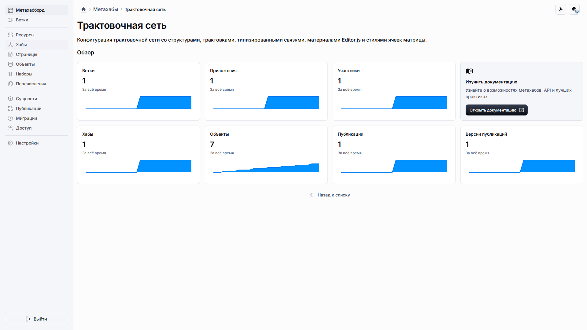
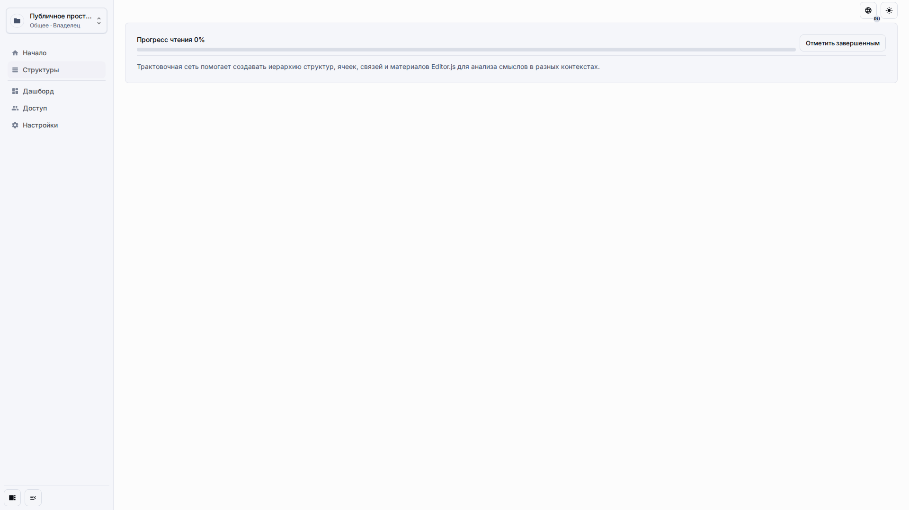
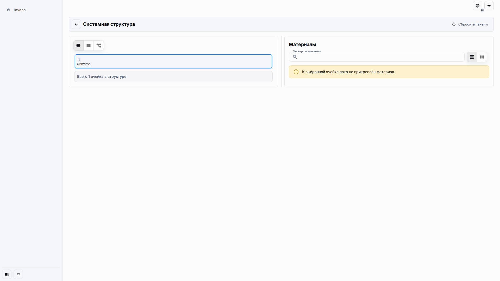

# Начало работы

Начните здесь, если нужно подтвердить, что шаблон, публикация, связанное приложение и опубликованное рабочее пространство соединены.

## Роль и цель

Страница предназначена для владельца, который готовит первое рабочее приложение, и для редактора, который получает к нему доступ.

## Предварительные условия

-   Шаблон трактовочной сети доступен в каталоге метахабов.
-   Вы можете создать или импортировать метахаб и создать связанное приложение из его публикации.
-   Для демонстрационного пути используйте подготовленный файл снимка из репозитория.

## Порядок работы

1. Создайте или импортируйте метахаб трактовочной сети и откройте его после завершения импорта.

2. Откройте связанное приложение. Войдите, чтобы использовать выбор рабочего пространства и авторизованную навигацию; анонимный посетитель публичного приложения увидит режим только для чтения.

3. Откройте публичное приложение в браузере без входа, чтобы просмотреть настроенное входное Рабочее пространство без элементов редактирования.

## Ожидаемый результат

В авторизованном рантайме участники приложения могут открыть **Структуры** и выбрать доступное им рабочее пространство через переключатель пространства. В анонимном публичном представлении переключателя нет: сервер выбирает явно настроенное входное рабочее пространство или единственное активное общее пространство. Если однозначного пространства нет, публичное приложение открывается с локализованным сообщением, не предоставляя операций изменения содержимого.

## Что проверить

-   Название импортированного метахаба соответствует шаблону трактовочной сети.
-   Связанное приложение открывается без отдельного сервера разработки.
-   Пользователи видят только обычную навигацию продукта и локализованные подписи.
-   Публичный доступ разрешает только чтение; редактирование, шаблоны, Избранное и выбор рабочего пространства требуют авторизованного рантайма.

## Связанные страницы

-   [Создание и публикация](create-and-publish.md)
-   [Экспорт и импорт снимков](../guides/snapshot-export-import.md)
-   [Создание приложений](../guides/creating-application.md)
