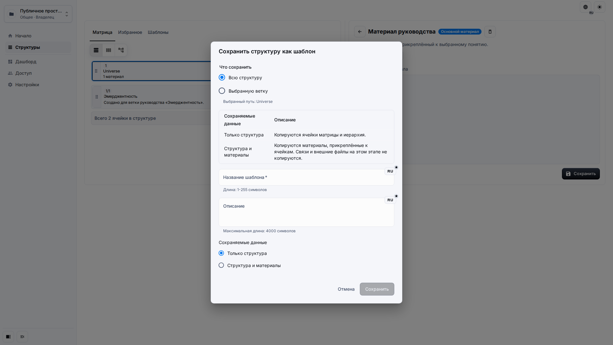
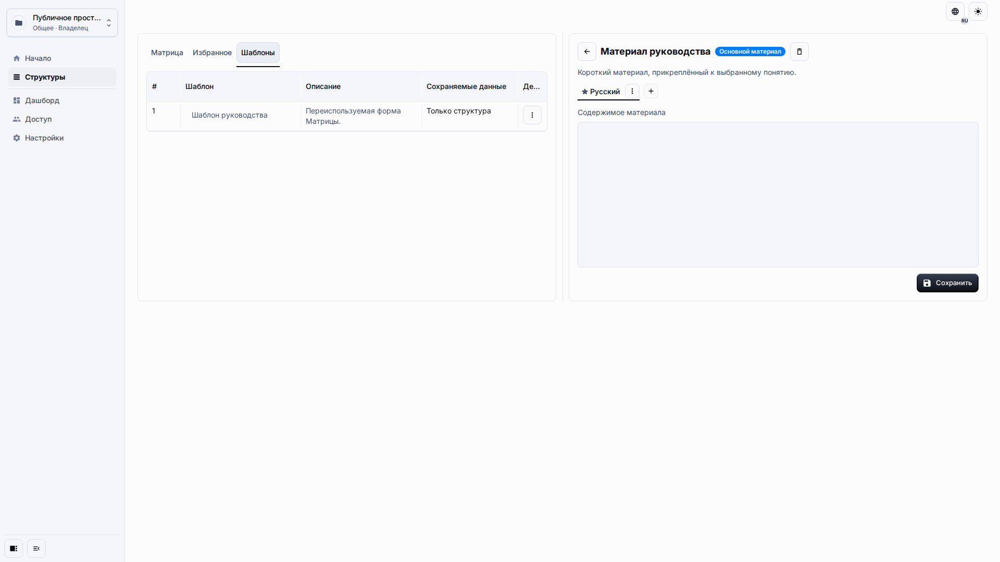
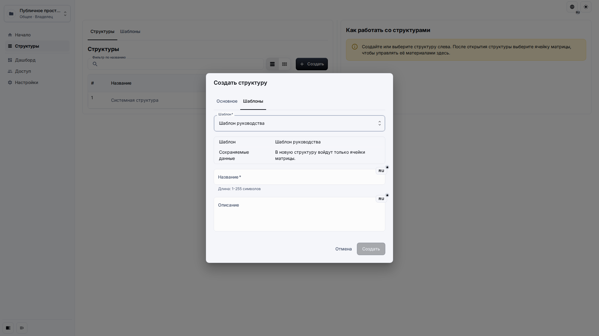
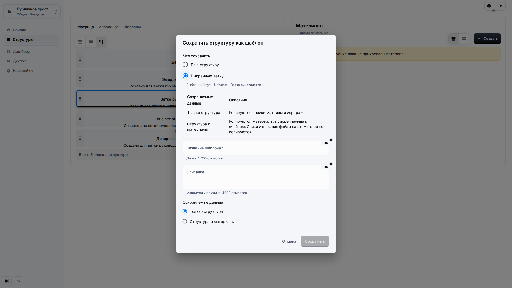

# Шаблоны

Шаблоны позволяют редакторам повторно использовать структуру Матрицы внутри того же рабочего пространства приложения. Шаблон может скопировать только структуру или структуру вместе с Материалами.

## Роль и цель

Страница предназначена для редактора, которому нужно сохранить полезную форму Матрицы и позже создать из неё другую Структуру.

## Предварительные условия

-   Вы можете редактировать Матрицу, которую нужно превратить в шаблон.
-   Панели шаблонов включены в Настройках приложения.
-   Ваша роль разрешает и создание, и изменение содержимого.

## Порядок работы

1. Откройте Матрицу и нажмите **Сохранить как шаблон**.

2. Откройте вкладку **Шаблоны**, чтобы просмотреть доступные шаблоны и политику сохранённых данных.

3. В режиме нескольких Структур создайте Структуру и выберите вкладку **Шаблоны** в диалоге создания.

4. Чтобы сохранить часть иерархии, выберите её корневую ячейку, откройте **Сохранить как шаблон** и выберите **Выбранную ветку**.

**Вставка в существующую иерархию:** выберите ячейку назначения и откройте в её меню **Действия с ячейкой → Вставить сохранённый шаблон**. Просмотрите шаблон и нажмите кнопку **Вставить в «имя ячейки»**. Корневая ячейка шаблона станет дочерней для выбранной ячейки.

## Ожидаемый результат

Сохранённый шаблон доступен только в текущем рабочем пространстве приложения. Шаблон может содержать всю Структуру или выбранную ветвь иерархической Матрицы. В иерархическом режиме редактор может создать из шаблона новую Структуру или вставить шаблонную структуру ниже выбранной ячейки текущей Структуры. Если шаблон включает Материалы, при создании или вставке приложение назначает новые идентификаторы ячейкам, строкам и Материалам и прикрепляет скопированные Материалы к соответствующим ячейкам. Исходная Матрица и сохранённый шаблон не меняются. Для вставки редактору нужны разрешения на создание и изменение содержимого активного рабочего пространства.

## Что проверить

-   Политика сохранённых данных соответствует вашему намерению.
-   Выбранная ветвь доступна для иерархических ячеек; для Матрицы с независимыми строками выбирайте всю Структуру.
-   Действие **Вставить сохранённый шаблон** доступно у выбранной ячейки в иерархическом режиме; оно добавляет содержимое ниже этой ячейки и не заменяет её.
-   Список шаблонов показывает понятные названия и описания.
-   Режим одной системы скрывает создание дополнительной Структуры из шаблона, но оставляет сохранение текущей Матрицы как шаблона.

## Связанные страницы

-   [Настройки приложения](application-settings.md)
-   [Рабочее пространство и Матрица](workspace-and-matrix.md)
-   [Ячейки и Материалы](cells-and-materials.md)
