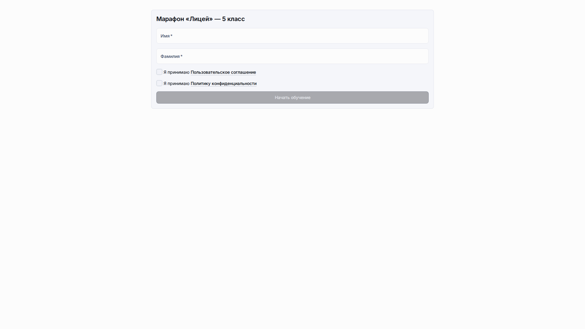
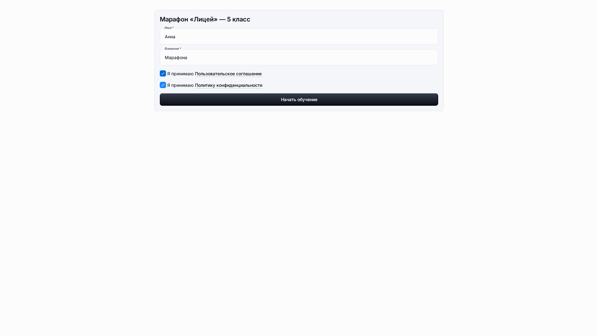
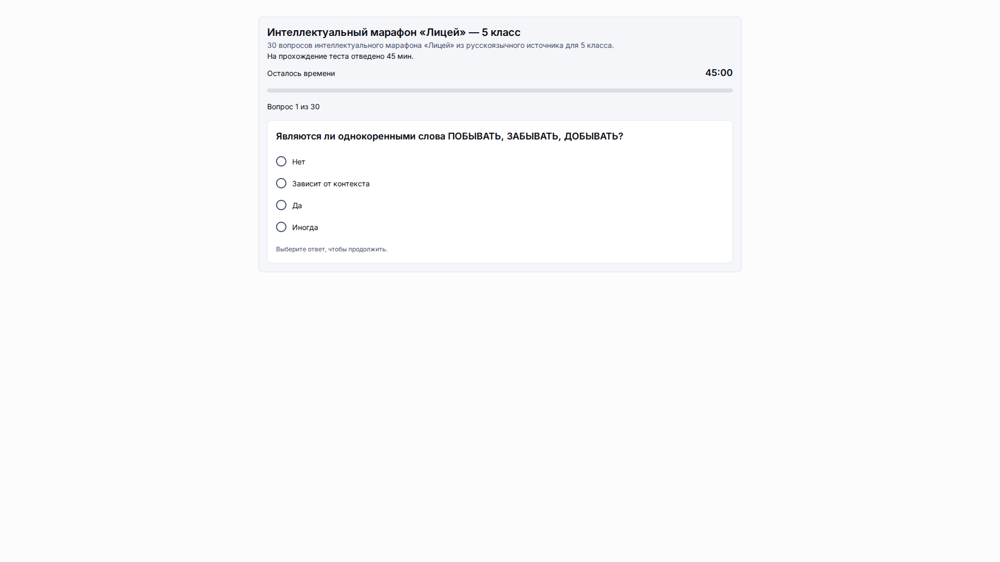
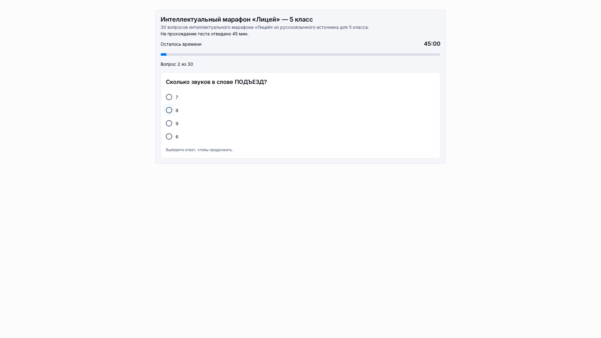
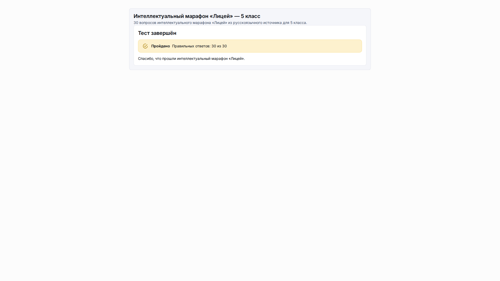
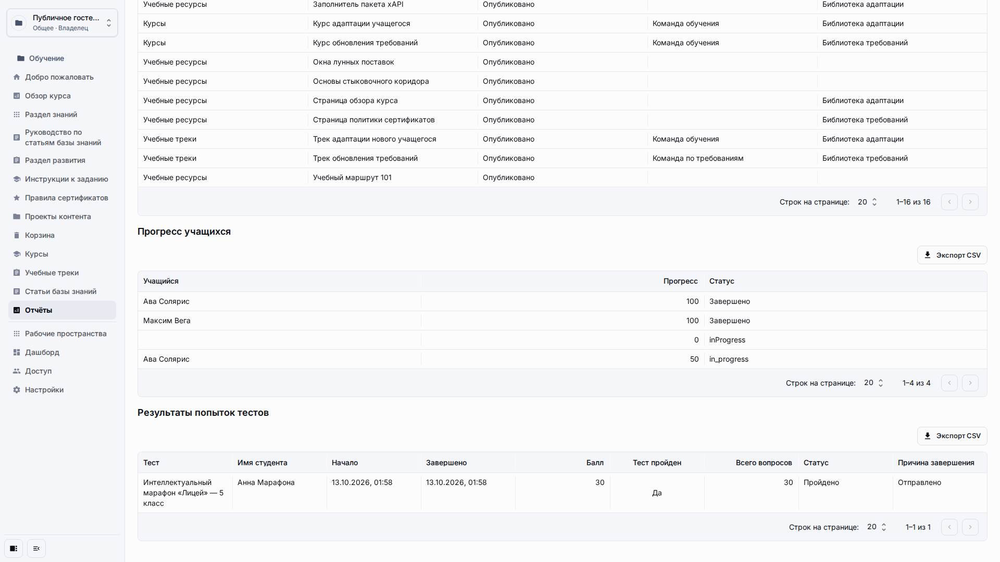

# Гостевой доступ

Для каждого класса создаётся своя публичная ссылка на тест «Интеллектуальный марафон». Участник открывает её в браузере, вводит имя и проходит тест без регистрации на платформе. Ниже показан тест для 5 класса; в остальных классах те же шаги и свои вопросы.

## Как пройти тест

1. Откройте ссылку, которую выдали для вашего класса. Убедитесь, что на странице указано название марафона и есть гостевая анкета. Входить в аккаунт или создавать его не нужно. Если организатор прислал короткую ссылку, откройте её: она ведёт на ту же страницу начала теста.
   

2. Введите имя и фамилию, затем примите Пользовательское соглашение и Политику конфиденциальности. Для начала теста нужно поставить оба флажка. Для этого мероприятия проверка «Я не робот» отключена. Когда анкета заполнена, нажмите **«Начать обучение»**. Тест откроется в той же вкладке браузера. В примере «Шестая муза» сначала показывается заглавная страница блока, а таймер начинает идти сразу.
   

3. Нажмите **«Продолжить»**, чтобы открыть вопросы блока, и отвечайте по порядку. В каждом вопросе четыре варианта, а на весь тест отводится 45 минут. В тесте с блоками сначала прочитайте заголовок и введение блока; по умолчанию таймер продолжает идти на таких страницах, но организатор может включить его остановку. По умолчанию вопросы нумеруются сквозным образом; можно включить нумерацию внутри блоков, например `1.1` и `2.1`. После выбора ответ по умолчанию сразу сохраняется и после подтверждения сервера открывается следующий вопрос. Организатор может включить подтверждение ответа в настройках теста; тогда выбранный вариант можно изменить до нажатия **«Отправить ответ»**. Если сохранить ответ не удалось, оставьте страницу открытой и повторите отправку выбранного варианта. Во время прохождения тест не показывает, какой вариант правильный.
   

4. Продолжайте, пока не ответите на все 30 вопросов. После последнего ответа откроется итог: количество правильных ответов и завершающее сообщение организатора. Результат сохраняется вместе с именем и временем прохождения. Если время закончится раньше, приложение оценит ответы, которые уже были сохранены.
   

5. Если страница перезагрузилась или соединение ненадолго пропало, снова откройте ссылку своего класса в том же браузере. Незавершённая попытка продолжится с сохранёнными ответами и прежним сроком окончания. После прохождения уполномоченные сотрудники смогут увидеть имя участника, класс, время завершения и балл в отчёте приложения.
   

## Для организаторов

Подготовьте и опубликуйте в рабочем пространстве приложения отдельный тест для каждого класса:

-   Откройте пункт **Тесты** в меню приложения или выберите **Проекты контента → Тесты**. Создайте тест, добавьте вопросы и четыре варианта ответа к каждому, отметьте правильный вариант, задайте время и завершающее сообщение. Настройка **«Подтверждать ответ перед переходом»** по умолчанию выключена; включите её, если участник должен нажать **«Отправить ответ»** после выбора.
-   Для теста с блоками добавьте упорядоченные строки в таблицу **Блоки**, задайте заголовок и необязательное введение для каждого, затем выберите нужный блок в поле **Блок** у каждого вопроса. По умолчанию таймер идёт на вводных страницах; включите **«Останавливать таймер на вводных страницах блоков»**, чтобы приостанавливать его. Настройка **«Нумеровать вопросы внутри каждого блока»** заменяет сквозную нумерацию на формат `1.1`, `1.2`, `2.1`. Добавление первого блока к существующему тесту требует подтверждения перед назначением вопросов. Удаление последнего блока требует подтверждения возврата к обычному тесту. Отмена оставляет обе таблицы без изменений. Добавьте в каждый блок хотя бы один вопрос, затем сохраните тест, чтобы записать обе таблицы вместе.
-   Откройте вкладку **Ссылки для гостей**, выберите тест и нажмите **Создать**. Укажите понятное название и ключ доступа, затем выберите, какие поля анкеты показывать и какие сделать обязательными. Подтверждения Пользовательского соглашения и Политики конфиденциальности всегда обязательны. Для марафона обязательны имя и фамилия, поля почты и телефона скрыты, проверка на робота отключена.
-   В **Настройках приложения** сделайте приложение публичным, чтобы гостевые ссылки открывались без авторизации.
-   Откройте панель приложения и выберите **Гостевые и короткие ссылки**. В таблице **Полные гостевые ссылки на тесты** показан полный прямой адрес для каждого теста и кнопка **Копировать ссылку**. Скопируйте ссылку нужного класса и отправьте участникам. Если нужен короткий глобальный адрес, создайте его в форме на этой же странице, выбрав ссылку доступа к тесту. QR-код можно создать во внешнем сервисе по любому из этих адресов.

Гостевая ссылка задаёт правила анкеты и доступ к попытке. Короткий глобальный адрес — необязательный псевдоним этой гостевой ссылки. Пока идёт тестирование, приложение должно оставаться публичным, а ссылка доступа — активной. Для управления ими требуется право **Управление приложением**. Если соответствующие элементы недоступны, обратитесь к владельцу или администратору приложения.

Приложение сохраняет завершённые попытки, а сотрудники с правом просмотра отчётов могут их проверить. По публичной ссылке участник видит только собственную попытку и результат, но не результаты других участников и не отчёты сотрудников. Отключение гостевой ссылки теста или снятие приложения с публикации отзывает гостевой доступ, сохраняя результаты для авторизованных отчётов. При удалении рабочего пространства результаты архивируются вместе с ним; обычный отчёт показывает только активные рабочие пространства.

## Детали экрана

| Экран             | Что на нём показано                                                                                                 |
| ----------------- | ------------------------------------------------------------------------------------------------------------------- |
| Гостевой вход     | Публичная ссылка теста и анкета участника.                                                                          |
| Вводная страница  | Заголовок и введение текущего блока, а также кнопка **«Продолжить»** для перехода к вопросам.                       |
| Первый вопрос     | Четыре варианта, номер вопроса и таймер.                                                                            |
| Следующий вопрос  | Появляется после сохранения ответа: сразу по умолчанию или после подтверждения участником, если настройка включена. |
| Итог              | Балл участника и завершающее сообщение.                                                                             |
| Отчёт сотрудников | Участник, время завершения и балл за тест.                                                                          |

## Связанные страницы

-   [Опыт учащегося](learner-experience.md)
-   [Отчёты LMS](reports.md)
-   [Техническое руководство по гостевому доступу](../guides/lms-guest-access.md)
