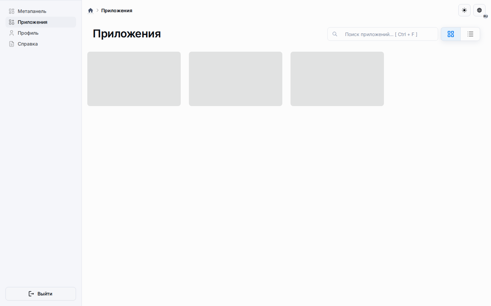
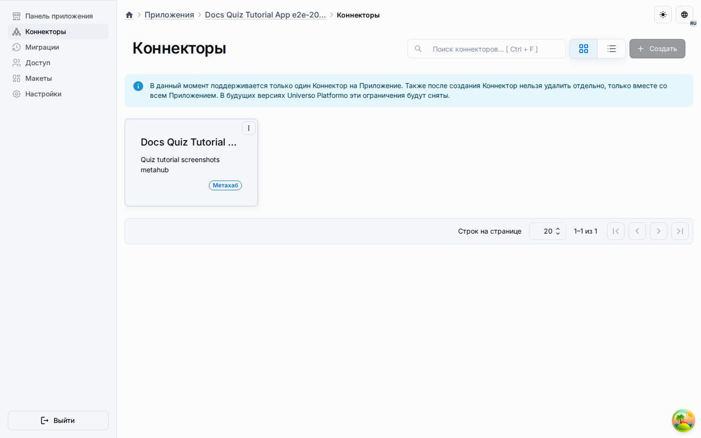
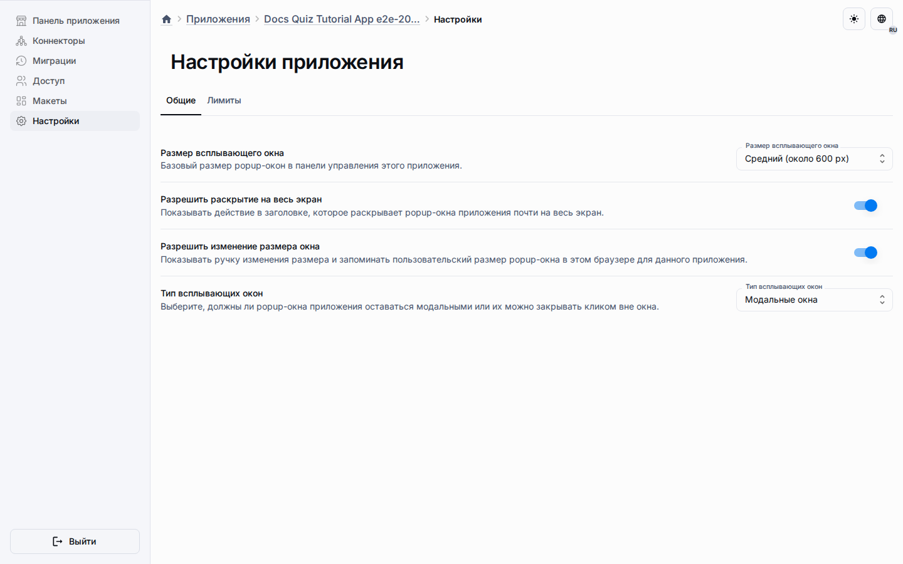
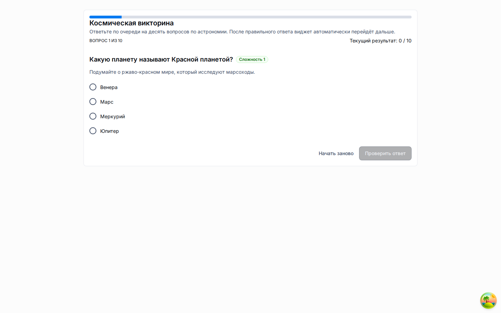

# Приложения

Приложения — это исполняемая поверхность доставки платформы.
Метахаб подготавливает исходную модель, публикация фиксирует кандидат релиза, а приложение превращает этот опубликованный контракт в управляемый рантайм.

## Чем владеет приложение

-   ссылка на связанную публикацию, которая используется для доставки рантайма;
-   состояние коннектора и синхронизации схемы;
-   рантайм-участники и граница доступа;
-   настройки панели управления приложением;
-   финальный рантайм-маршрут по адресу `/a/:applicationId`.

## Основные поверхности

| Поверхность | Назначение                                                                        |
| ----------- | --------------------------------------------------------------------------------- |
| Обзор       | Карточки состояния и общая сводка для связанного рантайма.                        |
| Коннекторы  | Управляют связью с публикацией и синхронизацией схемы.                            |
| Миграции    | Показывают состояние и историю рантайм-схемы.                                     |
| Настройки   | Настраивают поведение панели управления приложением и лимиты рабочих пространств. |
| Рантайм     | Отдаёт опубликованную пользовательскую поверхность.                               |

## Настройки панели управления

Страница настроек приложения теперь содержит реальный контракт для общих настроек вместо временного текста-заглушки.
Эти настройки хранятся в `applications.obj_applications.settings` и возвращаются через потоки списка, деталей и обновления приложения.

| Настройка                     | Значение                                                                                                                                                                                            |
| ----------------------------- | --------------------------------------------------------------------------------------------------------------------------------------------------------------------------------------------------- | ---------------------------------------------------------------- |
| Предустановка размера диалога | Базовая ширина диалога в административной поверхности приложения.                                                                                                                                   |
| Полноэкранный режим           | Можно ли разворачивать диалог в полноэкранный режим.                                                                                                                                                |
| Изменение размера             | Доступен ли элемент изменения размера.                                                                                                                                                              |
| Поведение закрытия            | Остаётся ли диалог строгим модальным окном или разрешает закрытие по клику вне окна.                                                                                                                |
| Видимость                     | Закрытое или публичное приложение. Переключение публичного приложения в закрытое блокирует новые прямые присоединения и разрешение публичных runtime-ссылок; анонимные переходы по адресу `/a/<uuid | alias>` закрытого приложения перенаправляются на страницу входа. |
| Режим рабочих пространств     | Только для чтения после создания, потому что управляет структурой runtime-схемы.                                                                                                                    |
| Лимиты рабочих пространств    | Лимиты строк по рабочим пространствам для поддерживаемых объектов.                                                                                                                                  |

## Граница области действия

Настройки диалогов приложения влияют на панель управления приложения под `/a/:applicationId/admin`.
Они не меняют публичный рантайм на `/a/:applicationId`.
Также они не заменяют проектные настройки метахаба и глобальные настройки диалогов на `/admin`.

## Публичный и авторизованный рантайм

Видимость приложения определяет, доступно ли разрешение анонимного публичного рантайма. Для публичного приложения backend отдаёт ограниченную проекцию Дашборда только для чтения и сам выбирает настроенное входное рабочее пространство. Публичный просмотр не принимает изменения содержимого и не позволяет выбрать произвольное рабочее пространство. В нём нет авторизованных действий редактирования, шаблонов и личного Избранного.

Участники приложения используют авторизованный рантайм и выбор рабочего пространства, доступного им по правам. Чтение и запись проверяются с учётом членства в приложении и активного рабочего пространства. Публичный просмотр предназначен для анонимного чтения, авторизованный рантайм — для редактирования и личных функций пространства. Это описание контракта в репозитории и не утверждает, что какой-либо production-хост настроен или доступен.

## Настройка виджетов на уровне приложения

Макеты приложения материализуются из связанной публикации метахаба.
Администраторы приложения могут уточнять поддерживаемые настройки виджетов в материализованном макете, не меняя исходный шаблон метахаба.
Для виджета рабочего пространства Трактовочной сети кнопка настроек виджета в макете открывает тот же типизированный контракт настроек Матрицы, который используется на странице Настройки панели управления.

Поверхность макета показывает, унаследован ли виджет из публикации метахаба или уже настроен на уровне приложения.
После такой настройки опубликованный рантайм использует конфигурацию виджета приложения до следующего обновления приложения из новой публикации.

Политика переопределений рабочих пространств задаётся на уровне приложения.
В отдельных рабочих пространствах видны и изменяемы только настройки, разрешённые этой политикой; заблокированные настройки продолжают использовать значение приложения.

Настройки стиля ячеек трактовочной сети могут относиться ко всему рабочему пространству или к одному экземпляру виджета. Runtime проверяет экземпляр по активному макету приложения и применяет разрешения только для точной цели. Политика одного виджета Матрицы не открывает переопределения для другого экземпляра виджета.

## Данные Дашборда и размещение виджетов

Макеты Дашборда используют общий реестр виджетов и сохраняемый граф размещений. Виджет хранит настройки представления и привязки источника, а бизнес- и контентные записи принадлежат своим типам Сущностей. Вложенные виджеты связываются через родительский экземпляр и слот в размещениях, а не через массивы дочерних виджетов в конфигурации.

Приложение наследует опубликованные размещения и может изменять только разрешённые реестром настройки и параметры размещения. Сброс восстанавливает состояние опубликованного источника. В рантайме виджет получает ограниченные по объёму данные, разрешённые текущему пользователю.

См. [виджеты на основе Сущностей](../architecture/entity-backed-widgets.md) с правилами владения и [руководство по макетам приложений](../guides/application-layouts.md) с порядком настройки и синхронизации.

## Рантайм-модель с рабочими пространствами

Когда `workspacesEnabled` включён, рабочие данные рантайма привязываются к текущему рабочему пространству пользователя.
Владельцы и участники получают личное рабочее пространство во время начальной подготовки или выдачи доступа, могут создавать общие рабочие пространства, а владельцы общего рабочего пространства могут добавлять активных участников приложения по email.
Рантайм-строки разрешаются внутри выбранного рабочего пространства, а поддерживаемые лимиты объектов применяются на уровне рабочего пространства, а не глобально.
Так приложения остаются частью общей платформенной модели совместной ERP- и CMS-подобной работы с рантайм-данными.

## Рантайм маркетинговой страницы

Приложения, созданные из публикации `marketing-page`, выбирают управляемый
данными marketing renderer до инициализации CRUD-состояния дашборда.
Настройки внешнего вида (режим темы, разрешённые цвета, видимость и порядок
секций) принадлежат приложению, а текст и записи контента остаются в
опубликованной модели Объектов. Рабочие пространства изолированы, а сброс
доступен только авторизованному владельцу или администратору приложения.
Полный контракт описан в [руководстве по шаблону маркетинговой страницы](marketing-page-template.md).

## Порядок поставки

1. Свяжите приложение с публикацией.
2. Запустите синхронизацию схемы или создайте рантайм-схему, если она ещё не готова.
3. Откройте настройки приложения, чтобы настроить поведение панели управления и лимиты рабочих пространств.
4. Настройте материализованные макеты и виджеты, если конкретному развёрнутому приложению нужно собственное поведение.
5. Используйте коннекторы, миграции и другие диалоги панели управления с сохранённым контрактом представления.
6. Откройте финальный рантайм-маршрут, чтобы проверить опубликованный пользовательский опыт.

## Пример с квизом

В сценарии с квизом метахаб владеет модулем виджета и его размещением в макете, а приложение отвечает за доставку рантайма и поведение панели управления.
Это значит, что вопросы квиза и размещение виджета приходят из публикации, а размер и поведение закрытия диалога коннектора задаются записью настроек приложения.
Сценарий копирования сохраняет эти настройки приложения, поэтому скопированные приложения получают то же поведение диалогов панели управления.

## Связь с админкой

Раздел администрирования может задавать глобальные политики платформы, но настройки приложения остаются локальными для каждого приложения.
Используйте администрирование, когда нужно платформенное управление на общем уровне.
Используйте настройки приложения, когда одна панель управления приложения должна вести себя иначе, чем другая.

Продолжайте с [туториалом по приложению-квизу](../guides/quiz-application-tutorial.md), чтобы пройти конкретный сквозной сценарий в браузере.
