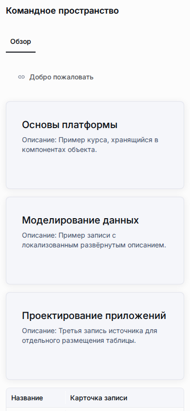

# Шаблон Messenger App



`messenger-app` — это шаблон макета приложения для опубликованного рантайма только для чтения внутри веб-представлений Telegram или MAX. Он использует общие реестры макетов и виджетов приложения, а также изолированный рендерер `@universo-react/apps-template-mui`. Тот же публичный URL открывается и в обычном браузере.

Messenger — шаблон макета, а не отдельный тип приложения или шаблон метахаба. Создайте приложение обычным способом и дождитесь готовности его схемы рантайма. При создании первого глобального макета в разделе **Приложение → Макеты** выберите `messenger-app` в существующем списке шаблонов. Шапка, локализованная вкладка «Обзор» и автоматически сформированное меню сущностей создаются в той же транзакции, что и макет; без макета рантайм Messenger не выбирается. В меню попадают опубликованные страницы и объекты, явно помеченные для основной навигации. В нём нет переходов в рабочие пространства и администрирование, технических идентификаторов или строк записей. Первый активный глобальный макет становится основным. В макете есть три семантические области: `top` (шапка), `center` (основной контент), `bottom` (подвал и действия).

## Создание приложения только для чтения

Добавляйте поддерживаемые виджеты в существующем редакторе макетов. MVP включает обязательные виджеты сводных карточек, списков и таблиц записей, деталей записи, вкладок, предпросмотра ресурса, колонок, графика и просмотр связей только для чтения. Сервер проверяет размещения для шаблона Messenger и передаёт публичному рантайму только ограниченные данные, безопасные для анонимного просмотра. Навигация платформы, переключение рабочих пространств, авторинг, администрирование и мутации не входят в поверхность Messenger.

Контент остаётся в опубликованных записях метахаба приложения. Размещения виджетов задают композицию и представление, но не копируют содержимое в JSON виджета. Стандартные операции копирования, снимка, восстановления, синхронизации и материализации сохраняют выбранный шаблон и его размещения.

Новый макет Messenger содержит общий заголовок и локализованную вкладку «Обзор» с автоматически сформированным меню опубликованных сущностей в центральной области; нижняя область пуста. Это обзор сущностей, а не список записей. Виджетам с данными, например спискам записей и сводным карточкам, нужна явная привязка к реальному источнику. Добавьте виджет и настройте привязку, чтобы показать опубликованные записи; до этого у него отображается общее локализованное пустое состояние. Демонстрационные записи и фиктивные привязки не создаются.

### Разрешение полей для анонимного рантайма Messenger

В редакторе компонентов метахаба откройте вкладку «Представление» и включайте «Разрешить анонимный показ в Messenger» только для полей, все значения которых безопасно показывать всем. По умолчанию настройка выключена. Анонимные проекторы Messenger пропускают только явно разрешённые поля и продолжают исключать скрытые, серверные, технические и конфиденциальные поля. Это заявление автора, а не автоматическое распознавание персональных данных: проверяйте записи в разрешённом поле и не храните там имена, контактные данные, учётные данные и другую приватную информацию.

## Публичный доступ и обнаружение в каталоге

Доступ к рантайму и обнаружение в каталоге управляются независимо. Настройка **Публичное** определяет, может ли анонимный посетитель открыть опубликованный рантайм. Настройка **Показывать в списке приложений** определяет, появится ли публичное приложение в обычном каталоге для пользователей, не состоящих в его участниках.

| Состояние приложения                                 | Видно неучастникам в каталоге                                          | Прямой публичный рантайм                |
| ---------------------------------------------------- | ---------------------------------------------------------------------- | --------------------------------------- |
| Публичное и показано в каталоге                      | Да                                                                     | Доступен, если опубликован и готов      |
| Публичное и скрыто из каталога                       | Нет                                                                    | Доступен, если опубликован и готов      |
| Закрытое, независимо от настройки каталога           | Нет                                                                    | Анонимным посетителям недоступно        |
| Участник или разрешённый привилегированный `showAll` | Видимость определяется существующими правами участника или привилегией | Действуют существующие правила рантайма |

Скрытие приложения в каталоге не является контролем доступа. Участники сохраняют обычный доступ, а публичное приложение, скрытое из каталога, остаётся доступным по UUID или настроенному публичному адресу. Переключение публичного/закрытого режима не удаляет сохранённую настройку каталога.

## Привязка ботов Telegram и MAX

Администраторы приложения управляют привязками ботов в настройках приложения. Каждая привязка указывает платформу и имя бота; одно приложение может иметь несколько привязок, в том числе к нескольким ботам одной платформы. Статус — это запись, которой управляет оператор; он не означает, что Universo обращалась к внешней платформе или проверила настройки бота.

Необязательное отображаемое имя — короткая операторская метка длиной до 120 кодовых точек Unicode. Форма, API и база данных отклоняют распространённые форматы контактов и секретов, включая похожие на телефоны строки с не-латинскими десятичными цифрами; такая проверка не распознаёт все варианты содержимого, поэтому не указывайте здесь контактные данные, сведения о пользователях или секреты.

Имя бота Telegram должно содержать от 5 до 32 латинских букв, цифр или символов подчёркивания; начальный `@` удаляется перед сохранением. Имя бота MAX должно содержать от 11 до 60 латинских букв, цифр или символов подчёркивания, начинаться с буквы, оканчиваться на `bot` или `_bot` и не содержать `@`. См. [правила имён ботов Telegram](https://core.telegram.org/bots/features) и [требования к созданию ботов MAX](https://dev.max.ru/docs/chatbots/bots-create/create).

| Статус    | Значение                                                             |
| --------- | -------------------------------------------------------------------- |
| Черновик  | Привязка сохранена, но ещё не отмечена готовой к запуску.            |
| Активна   | Интерфейс управления может показывать сформированную ссылку запуска. |
| Отключена | Обратимая пауза; привязку можно включить снова.                      |

Отзыв — необратимое действие жизненного цикла, а не четвёртый статус. Запись привязки и её идентификатор запуска остаются зарезервированными; привязку нельзя включить повторно, а идентификатор — использовать снова.

Ссылка запуска содержит канонический публичный URL приложения и созданный сервером `short_id`:

```text
https://t.me/<bot_username>?startapp=<short_id>
https://max.ru/<bot_username>?startapp=<short_id>
```

Укажите канонический публичный URL Web App в настройках **Main Mini App** бота Telegram или в поддерживаемой записи `web_app`. Для бота MAX укажите тот же URL в настройках Mini App. Создание и модерация ботов, токены и учётные данные внешних платформ остаются в аккаунте владельца платформы и не управляются Universo. Наличие привязки не подтверждает, что внешний бот настроен.

Изменения и необратимый отзыв используют контракт ожидаемой версии API привязок. Если другой администратор уже изменил привязку, запрос с более старой версией отклоняется; перед повтором необходимо загрузить актуальное состояние.

## Рантайм и границы безопасности

-   Анонимный рантайм Messenger доступен только для публичного, опубликованного и готового приложения и работает только для чтения.
-   `short_id` — подсказка для атрибуции, а не учётные данные или разрешение на доступ. Для неизвестной, отключённой или отозванной атрибуции открывается обычный публичный рантайм приложения.
-   Интеграции мостов Telegram и MAX определяются отдельно и являются дополнительными возможностями. Обычная навигация в браузере работает без обоих мостов.
-   Если MAX предоставляет `WebApp.getViewportSize()`, рантайм проверяет полученную высоту и повторно запрашивает её при изменении размера окна, `visualViewport` и ориентации. При отсутствии API, ошибочном значении или сбое сохраняется CSS-fallback.
-   `initDataUnsafe` и личность пользователя из моста не используются для авторизации. MVP не выполняет вход пользователя Universo по данным запуска мессенджера.
-   Функция не хранит токены ботов, секреты вебхуков, `initData`, идентификаторы пользователей мессенджера или учётные данные сессий.
-   Публичные данные выбираются и ограничиваются серверными проекторами. Браузер не выбирает рабочее пространство и не отправляет мутации рантайма.
-   Метрики источника запуска FR-038 отложены в этом MVP: в репозитории нет продуктового telemetry sink. Рантайм может прочитать только непрозрачную подсказку `start_param` и запросить same-origin resolver, чтобы проверить её связь с активной привязкой уже открытого приложения. Эта подсказка не даёт доступ; рантайм не доверяет `initDataUnsafe`, не читает личность пользователя мессенджера и не сохраняет события источника запуска. Неизвестный, отключённый или отозванный идентификатор не мешает открыть обычный публичный рантайм.

## Проверка

Канонический fixture и сфокусированный E2E-гейт создают метахаб Messenger через API продукта, экспортируют и проверяют снимок, а затем импортируют его для проверки рантайма. Запустите проверку из корня репозитория:

```bash
pnpm run test:e2e:messenger-app:verify:local-supabase
```

Гейт использует минимальный профиль локальной Supabase, заново создаёт fixture, проверяет его контракт и отсутствие дрейфа, затем запускает сфокусированный Playwright-сценарий. Скриншоты браузера и сведения о размерах окон сохраняются в E2E-артефактах. Реальные клиенты Telegram и MAX требуют отдельной ручной приёмки; имитация моста в браузере не подтверждает настройки внешнего клиента или допуск бота.

См. также [Публичные приложения, адреса и глобальные короткие ссылки](public-applications-and-aliases.md), [Макеты приложения](../guides/application-layouts.md) и [Браузерное E2E-тестирование](../guides/browser-e2e-testing.md).

## Оформление

Шаблон мессенджера использует общий контракт `appearance`: аутентифицированный рантайм применяет resolved-пресет через host-injector (см. `docs/ru/platform/theme-presets.md`). Публичный payload мессенджера пока не проецирует токены оформления — анонимные рантаймы мессенджера отображают встроенную тему `universo-default`; проекция resolved-токенов в анонимный payload запланирована как следующая итерация.
