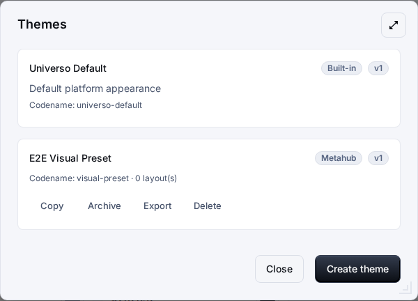
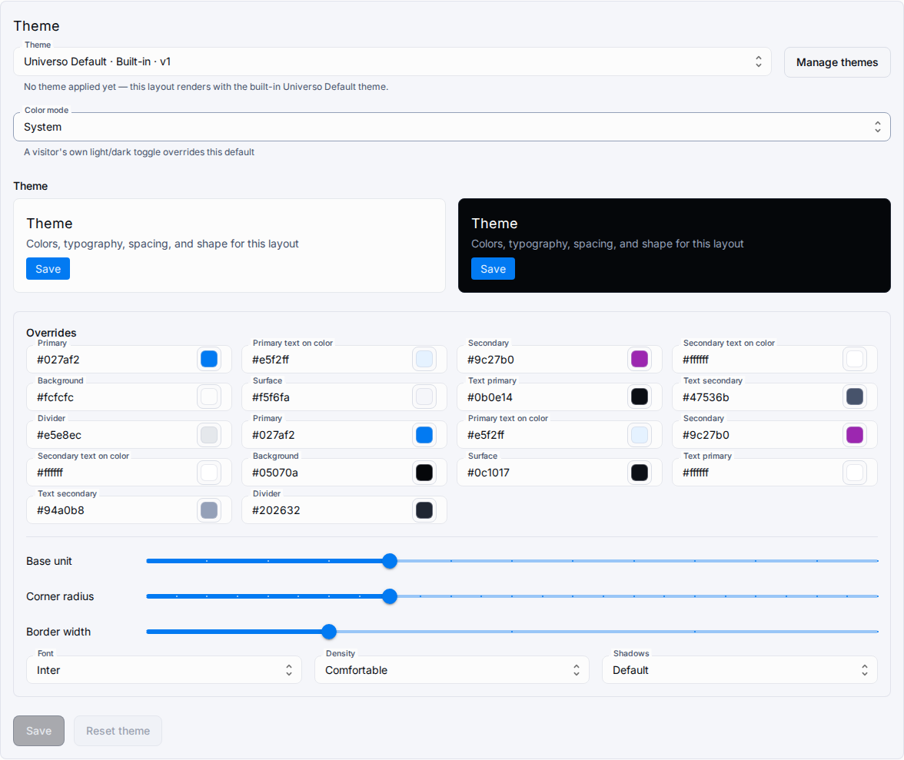

# Пресеты оформления (Appearance)

Именованные **пресеты оформления** (раздел «Оформление») задают визуальную идентичность макетов приложений: цвета, типографику, отступы, форму и тени. Пресеты — **данные, а не CSS**: валидированные JSON-токены, применяемые через CSS-переменные MUI. Произвольный CSS, сторонние шрифты, внешние URL и стили отдельных виджетов сознательно вне границ (ТЗ DOC-2026-004).

## Пресеты и области видимости

| Вид                        | Хранение                                                 | Изменение                                                        | Адресация                             |
| -------------------------- | -------------------------------------------------------- | ---------------------------------------------------------------- | ------------------------------------- |
| **Файловый пресет**        | `packages/universo-react-theme/src/presets/*.theme.json` | PR + пересборка (валидация сборки `FR-036`, уникальные codename) | codename, например `universo-default` |
| **БД-пресет (метахаб)**    | `metahubs.obj_theme_presets`                             | API/UI метахаба                                                  | UUID v7 + codename                    |
| **БД-пресет (приложение)** | `applications.obj_theme_presets`                         | API/UI приложения                                                | UUID v7 + codename                    |

Встроенный файловый пресет `universo-default` повторяет базовое оформление платформы и доступен везде. Копии получают новый codename, версию 1 и происхождение в `base_preset_id` (БД) или `base_preset_codename` (файл). Удаление пресета, используемого макетами, отклоняется (409 со списком использований); архивирование сохраняет работу существующих макетов и скрывает пресет из нового выбора.

## Оформление в макете

`config.appearance` каждого макета хранит:

-   `mode` — режим по умолчанию `system | light | dark`. Собственный переключатель посетителя (сохранённый `mui-mode`) его перекрывает.
    -   **Примечание о легаси:** оболочка платформы на Berry всё ещё хранит старый ключ `isDarkMode` в localStorage (редьюсер кастомизации `universo-react-store`). Это остаток прежней двойной системы хранения — в модели оформления он **не участвует**. Действующий приоритет: переключатель посетителя (`mui-mode`) → `appearance.mode` → `system`.
-   `preset` — `{ source: file | metahub | application, id, version }`.
-   `overrides` — разреженные переопределения токенов: отсутствующий ключ сохраняет значение пресета, `null` возвращает к нему.
-   `resolved` — **серверный** снимок `{ hash: sha256:…, tokens }`, пересчитываемый при сохранении/apply-latest. Клиент токены не сливает.

Макеты приложений, синхронизированные из метахаба, рендерят унаследованный resolved-снимок без чтения таблиц метахаба. Переразрешение унаследованного пресета возвращает 409 `THEME_PRESET_SOURCE_UNAVAILABLE`; скопируйте пресет в приложение (токены станут пресетом области приложения) или выберите другой.

## Токены

-   Цвета: только `#RRGGBB`, отдельно для light/dark — `primary`, `secondary` (с `contrastText`), `background.default/paper`, `text.primary/secondary`, `divider`.
-   Типографика: шрифт (`inter | system | serif | mono`), базовый размер 12–20, масштаб заголовков 1.1–1.4.
-   Отступы: базовый шаг 4–16, плотность `compact | comfortable` (compact умножает шаг на 0.75).
-   Форма: радиус 0–24, толщина границ 0–4.
-   Тени: `none | soft | default | strong`.
-   Лимиты: 64 КиБ на пресет и на resolved-снимок, не более 100 активных пресетов на область.

**Контраст (WCAG 2.1)**: пары текста поверх фонов страницы (`text.*` vs `background.*`) блокируют сохранение при < 4.5:1. Компонентные пары (`contrastText` на цветах бренда, цвета бренда на фонах) дают неблокирующие предупреждения при < 3:1 (1.4.11). Разделители декоративны и исключены.

## Рантайм

Публичный и аутентифицированный рантайм получают **только resolved-токены** (без ID пресетов); макеты без `appearance` рендерят снимок `universo-default`. `?themeVariant=light|dark|system` перекрывает режим оформления в запросе (намерение посетителя > режим макета). Клиент пересобирает MUI-тему только при изменении resolved-хэша; `resolved` не участвует в хэшах синхронизации/публикации, поэтому переразрешение пресета не помечает макеты как локально изменённые.

## API

-   Пресеты: `GET/POST /metahub/:id/theme-presets`, `GET/PATCH/DELETE …/theme-presets/:presetId`, `POST …/copy`, `GET …/export` (JSON-загрузка `<codename>.theme.json`; конфликт codename с файловым пресетом требует `?codename=`), тот же набор под `/applications/:id/theme-presets`.
-   Оформление макета: `PATCH /…/layouts/:layoutId/appearance`, `POST …/appearance/reset`, `POST …/appearance/apply-latest` (все принимают `expectedVersion`; 409 при конфликте).
-   Ошибки (ТЗ §11.5): `THEME_PRESET_NOT_FOUND`, `THEME_PRESET_INVALID`, `THEME_PRESET_VERSION_CONFLICT`, `THEME_PRESET_IN_USE`, `THEME_PRESET_SCOPE_FORBIDDEN`, `THEME_PRESET_SOURCE_UNAVAILABLE`, `THEME_APPEARANCE_RESOLVE_FAILED`, `THEME_EXPORT_FAILED`, `THEME_PRESET_LIMIT_REACHED`.

## Безопасность

Только типизированные allowlist-токены — неизвестные ключи (включая `__proto__`/`constructor`/`prototype`) отклоняются на валидации, merge резолвера защищён от prototype pollution. Никаких URL, `@import`, секретов и персональных данных: тема — публичные UI-данные. Все записи аудируются в append-only `rel_theme_preset_audits` (создание/изменение/копирование/архивирование/применение/экспорт). Scope и права проверяются на сервере (метахаб: мутации и экспорт требуют `manageMetahub`, чтение — членство; приложение: чтение следует настраиваемой политике чтения макетов — «видишь макет, видишь его оформление», а создание/копирование/архивирование/удаление/экспорт/apply остаются за `owner/admin`); таблицы пресетов защищены RLS и недоступны анонимным рантаймам. Файловые пресеты — read-only данные, видимые всем, кто видит макеты; DB-пресеты приложения живут строго внутри его scope без кросс-приложенческого доступа. Анонимный runtime-payload несёт только `{ mode, resolved: { hash, tokens } }` — без списка пресетов и внутренних идентификаторов.

## Включение / откат

Фича гейтится `THEME_PRESETS_ENABLED` (по умолчанию **true**); `false` скрывает API-роуты и UI авторинга. Таблицы пресетов доставляются независимо и без флага инертны. Чтобы перенести БД-пресет в файл: экспортируйте JSON, положите в `packages/universo-react-theme/src/presets/`, добавьте импорт в `src/presets/index.ts` (реестр — явный список импортов), и доставьте через PR + пересборку.
